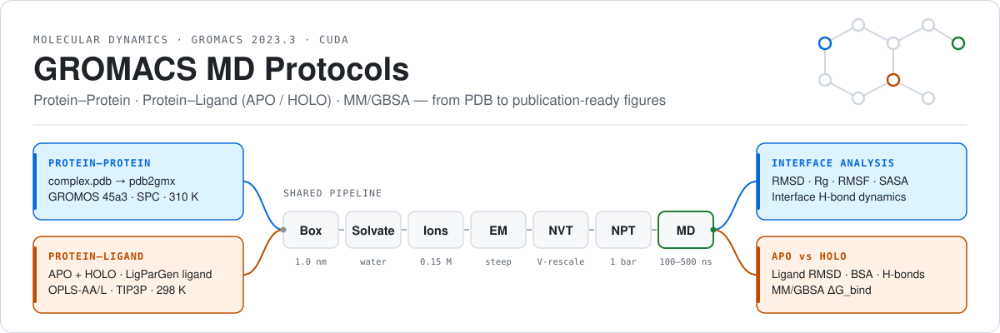
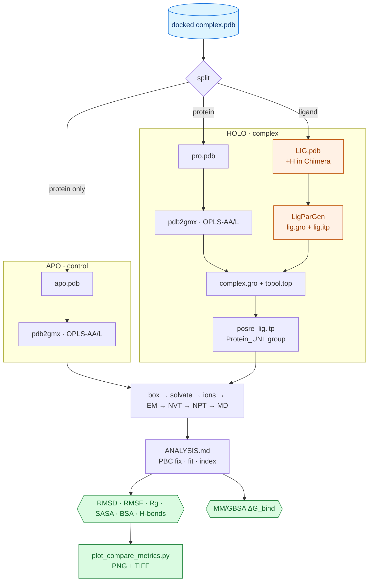
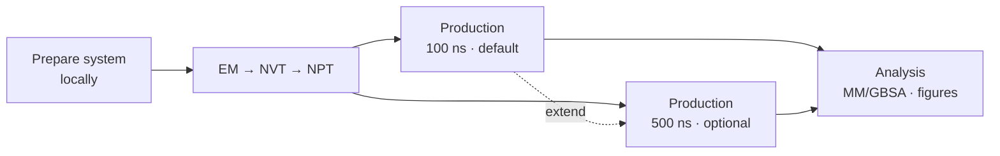

<div align="center">

<picture>
  <source media="(prefers-color-scheme: dark)" srcset="assets/banner-dark.svg">
  
</picture>

<br/>


**Reproducible, step-by-step GROMACS workflows for protein–protein complexes and protein–ligand (APO vs HOLO) systems —<br/>from a raw PDB file to equilibrated trajectories, comparative analysis, MM/GBSA, and publication-ready figures.**

[Workflows](#-workflows) ·
[Quick start](#-quick-start) ·
[Run options](#-run-options) ·
[Parameters](#%EF%B8%8F-simulation-parameters) ·
[Analysis](#-analysis-outputs) ·
[Plotting](#-plotting) ·
[Docs](#-documentation)

</div>

---

## 📌 Overview

This repository collects the protocols, GROMACS parameter (`.mdp`) files, and analysis scripts I use for molecular dynamics (MD) simulations of two kinds of systems:

| Track | Question it answers | Typical use |
|-------|---------------------|-------------|
| **Protein–Protein** | How stable is the interface between two proteins, and which hydrogen bonds hold it together? | receptor–ligand protein pairs (e.g. PD-1 / PD-L1, PDB 3BIK), variant comparisons |
| **Protein–Ligand** | Does a docked small molecule stay in its pocket, and does it change the protein's dynamics compared with the unbound (APO) state? | post-docking validation, ligand ranking with MM/GBSA |

Each track ships with the exact `.mdp` files, an annotated command-by-command guide, a troubleshooting section, and a consistent naming scheme so that the output `.xvg` files feed straight into the plotting script.

> [!NOTE]
> The step-by-step guides inside each folder are written in **Vietnamese** (this README is in English). All commands, file names and parameters are language-independent.

---

## 📂 Repository structure

```text
gromacs-md-protocols/
├── README.md
├── requirements.txt                 # numpy, matplotlib (plotting)
├── assets/                          # banner (light / dark)
│
├── protein-protein/
│   ├── README.md                    # full PRO–PRO protocol (PD-1/PD-L1 example)
│   └── mdp/                         # ions · minim · nvt · npt · md (100 ns) · md_500ns
│
├── protein-ligand/
│   ├── apo/
│   │   ├── README.md                # protein-only control simulation
│   │   └── mdp/                     # tc-grps = Protein Water_and_ions
│   ├── holo/
│   │   ├── README.md                # protein + ligand (LigParGen) simulation
│   │   └── mdp/                     # tc-grps = Protein_UNL Water_and_ions
│   ├── ANALYSIS.md                  # unified APO vs HOLO post-processing
│   ├── MMGBSA.md                    # binding free energy with gmx_MMPBSA
│   └── notebooks/
│       └── apo_quick_plots.ipynb    # quick RMSD / RMSF / Rg / SASA plots
│
├── scripts/
│   ├── prepare_system.sh            # PDB → solv_ions.gro + topol.top + index.ndx, with auto-repair
│   ├── fix_structure.py             # missing residues / atoms, non-standard residues (PDBFixer)
│   └── plot_compare_metrics.py      # APO vs HOLO comparison figures (PNG + TIFF)
│
├── runpod/                          # OPTIONAL: run the long simulations on rented GPUs
│   ├── README.md                    # step-by-step RunPod guide
│   ├── setup_gromacs.sh             # one-time GROMACS + CUDA build on the network volume
│   ├── run_md.sh                    # resumable EM → NVT → NPT → MD pipeline (pp | apo | holo)
│   ├── benchmark.sh                 # ns/day, run time and cost estimate
│   ├── extend_md.sh                 # continue a finished run, e.g. 100 → 500 ns
│   ├── pack_results.sh              # water-free trajectory + equilibration curves → .tar.gz
│   └── common.sh
│
└── docs/
    ├── INSTALL.md                   # Ubuntu/WSL, GROMACS 2023.3 CUDA build, conda envs
    ├── FORCE_FIELDS.md              # choosing a force field, water model and ligand parameters
    ├── EXTENDED_500NS.md            # OPTIONAL 500 ns production: files, extension, analysis tips
    ├── TROUBLESHOOTING.md           # common pdb2gmx / grompp / trjconv / MM-GBSA errors
    └── MD_results_interpretation.md # how to read RMSD, RMSF, SASA, H-bonds, ΔG_bind
```

---

## 🧭 Workflows

### Protein–Protein



```mermaid
flowchart LR
    A[(complex.pdb)] --> B[Remove HETATM]
    B --> C[editconf<br/>cubic, 1.0 nm]
    C --> D[pdb2gmx<br/>GROMOS 45a3 + SPC]
    D --> E[solvate]
    E --> F[make_ndx<br/>one group per chain]
    F --> G[genion<br/>neutral + 0.15 M NaCl]
    G --> H[EM]
    H --> I[NVT · 100 ps · 310 K]
    I --> J[NPT · 100 ps · 1 bar]
    J --> K[MD · 100 / 500 ns]
    K --> L{{RMSD · Rg · RMSF per chain<br/>SASA · interface H-bonds}}

    classDef io fill:#ddf4ff,stroke:#0969da,color:#0a3069
    classDef out fill:#dafbe1,stroke:#1a7f37,color:#116329
    class A io
    class L out
```

### Protein–Ligand (APO vs HOLO)



---

## 🚀 Quick start

```bash
# 1. clone
git clone https://github.com/129namworkkk/gromacs-md-protocols.git
cd gromacs-md-protocols

# 2. install GROMACS (CUDA build) and the conda environments → docs/INSTALL.md
source ~/gromacs-2023.3-cuda/bin/GMXRC
gmx --version                       # expect: GPU support: CUDA

# 3. pick a track, copy its .mdp files into a fresh working directory
mkdir -p ~/runs/my_complex && cp protein-ligand/holo/mdp/*.mdp ~/runs/my_complex/

# 4. follow the guide for that track
#    protein-protein/README.md · protein-ligand/apo/README.md · protein-ligand/holo/README.md
```

A HOLO run in five commands once the topology is built:

```bash
gmx grompp -f EM.mdp  -c solv_ions.gro -p topol.top -o em.tpr                         && gmx mdrun -v -deffnm em
gmx grompp -f NVT.mdp -c em.gro  -r em.gro  -p topol.top -n index.ndx -o nvt.tpr       && gmx mdrun -deffnm nvt
gmx grompp -f NPT.mdp -c nvt.gro -r nvt.gro -t nvt.cpt -p topol.top -n index.ndx -o npt.tpr && gmx mdrun -deffnm npt
gmx grompp -f MD.mdp  -c npt.gro -t npt.cpt -p topol.top -n index.ndx -o md_0_10.tpr   && gmx mdrun -deffnm md_0_10
```

---

## 🚦 Run options

The protocol is the same in every case — **prepare → EM → NVT → NPT → production → analysis**. Only the production length and the machine change.

| | Standard | Extended (optional) |
|---|---|---|
| **Production length** | **100 ns** — `md.mdp` / `MD.mdp` | **500 ns** — `md_500ns.mdp` / `MD_500ns.mdp` ([details](docs/EXTENDED_500NS.md)) |
| **Where to run** | your workstation, following the guides command by command | a rented GPU on [RunPod](runpod/README.md) with the automated pipeline |

The 500 ns files keep every physical setting of the 100 ns files and only change `nsteps` and the output interval (one frame per 100 ps → 5 000 frames), so all analysis commands stay the same. An existing 100 ns run can be extended to 500 ns without restarting.



On RunPod (or any Linux GPU machine) the whole simulation is one resumable command:

```bash
bash scripts/prepare_system.sh --system holo --pdb complex.pdb --lig-gro lig.gro --lig-itp lig.itp \
     --workdir /workspace/runs/my_complex                                                          # repair + topology + water + ions
bash runpod/run_md.sh --system holo --length 500 --workdir /workspace/runs/my_complex --quick-test   # 500-step smoke test
bash runpod/benchmark.sh --workdir /workspace/runs/my_complex --price 0.69                          # ns/day + cost (after --grompp-only)
bash runpod/run_md.sh --system holo --length 500 --workdir /workspace/runs/my_complex                # real run; re-run to resume
bash runpod/pack_results.sh --workdir /workspace/runs/my_complex                                     # water-free results to download
```

`--system` is `pp`, `apo` or `holo`; finished stages are skipped and production resumes from the last checkpoint (written every 15 min), so interruptible (spot) pods are safe to use.

### 🩹 Automatic structure repair

Crystal structures and docking outputs often have **missing residues** (unresolved loops), **truncated side chains**, non-standard residues (MSE, …) or leftover waters and ions — the source of errors such as *"atom CG used in that entry is not found in the input file"* or of energy minimisation blowing up across a chain gap.

[`scripts/prepare_system.sh`](scripts/prepare_system.sh) repairs the structure with [`fix_structure.py`](scripts/fix_structure.py) (PDBFixer) **before** `pdb2gmx`, retries `pdb2gmx` automatically if it still reports missing atoms, and then builds the box, water, ions and index groups — for holo it also merges the LigParGen ligand into `complex.gro` / `topol.top`:

| Problem in the input | What happens |
|----------------------|--------------|
| Internal gap ≤ 15 residues (needs SEQRES, or `--fasta`) | residues modelled |
| Longer gap / no sequence available | chain split with `TER` so no bond is drawn across the gap (warning) |
| Missing side-chain atoms, missing OXT | rebuilt |
| Non-standard residues (MSE → MET, …) | replaced |
| Waters, ions, buffer molecules | removed (keep with `--keep-het`) |

```bash
python scripts/fix_structure.py model.pdb --check-only          # report gaps only, no dependencies
bash scripts/prepare_system.sh --system apo --pdb docked.pdb --fasta target.fasta --workdir runs/apo
```

Choosing `--ff` / `--water` and matching ligand parameters: [docs/FORCE_FIELDS.md](docs/FORCE_FIELDS.md).

---

## ⚙️ Simulation parameters

Values below are read directly from the `.mdp` files in this repository.

| Setting | Protein–Protein | Protein–Ligand (APO / HOLO) |
|---------|-----------------|-----------------------------|
| Force field | GROMOS 45a3 | OPLS-AA/L (protein) + LigParGen OPLS-AA (ligand) |
| Water model | SPC | 3-site water (`spc216.gro` box) |
| Box | cubic, 1.0 nm to edge | triclinic, 1.0 nm to edge |
| Ions | Na⁺/Cl⁻, neutralised + 0.15 M | Na⁺/Cl⁻, neutralised + 0.15 M |
| Energy minimisation | steepest descent, F<sub>max</sub> < 1000 kJ mol⁻¹ nm⁻¹, ≤ 50 000 steps | steepest descent, F<sub>max</sub> < 1000 kJ mol⁻¹ nm⁻¹, ≤ 5 000 steps |
| NVT | 100 ps, V-rescale, **310 K**, position restraints | 500 ps, V-rescale, **298 K**, position restraints (protein + ligand) |
| NPT | 100 ps, Parrinello-Rahman, 1 bar | 500 ps, Berendsen, 1 bar |
| Production | **100 ns** (`md.mdp`, default) · **500 ns** (`md_500ns.mdp`, optional), Parrinello-Rahman | **100 ns** (`MD.mdp`, default) · **500 ns** (`MD_500ns.mdp`, optional), Parrinello-Rahman |
| Time step | 2 fs, LINCS on H-bonds | 2 fs, LINCS on H-bonds |
| Electrostatics | PME, r<sub>c</sub> = 1.0 nm | PME, r<sub>c</sub> = 1.2 nm |
| van der Waals | cut-off 1.0 nm, `DispCorr = EnerPres` | cut-off 1.2 nm, force-switch from 1.0 nm |
| Thermostat groups | `Protein  Non-Protein` | APO: `Protein  Water_and_ions` · HOLO: `Protein_UNL  Water_and_ions` |
| Trajectory output | every 10 ps (100 ns) · every 100 ps (500 ns) | every 20 ps (100 ns) · every 100 ps (500 ns) |

<details>
<summary><b>Throughput reference</b></summary>

The protein–protein `md.mdp` notes roughly **2.5 days per 100 ns on 1 GPU + 4 threads** for a medium-sized complex — a 500 ns run takes about five times as long. Measure your own speed with [`runpod/benchmark.sh`](runpod/benchmark.sh) or the `Performance:` line at the end of `md.log`. The CUDA build in [`docs/INSTALL.md`](docs/INSTALL.md) targets RTX 40-series GPUs (`GMX_CUDA_TARGET_SM=89`); change this value for other architectures ([`runpod/setup_gromacs.sh`](runpod/setup_gromacs.sh) detects it automatically).
</details>

---

## 📊 Analysis outputs

### Protein–Protein

| Metric | GROMACS tool | Output file |
|--------|--------------|-------------|
| Potential energy (EM), temperature (NVT), pressure & density (NPT) | `gmx energy` | `potential_em.xvg`, `temperature_nvt.xvg`, `pressure_npt.xvg`, `density_npt.xvg` |
| Backbone RMSD | `gmx rms` | `rmsd.xvg` |
| Radius of gyration | `gmx gyrate` | `gyrate.xvg` |
| Per-residue RMSF for each partner | `gmx rmsf -res` | `rmsf_PDL1.xvg`, `rmsf_PD1.xvg` |
| SASA | `gmx sasa` | `sasa.xvg` |
| Interface H-bonds: count, autocorrelation, distance & angle distributions | `gmx hbond` | `hbnum.xvg`, `hbac.xvg`, `hbdist.xvg`, `hbang.xvg` |

### Protein–Ligand

| Metric | APO | HOLO | Ligand / complex |
|--------|:---:|:----:|:----------------:|
| Backbone RMSD | `rmsd_apo.xvg` | `rmsd_holo.xvg` | `rmsd_lig.xvg` (fit on protein) |
| Cα RMSF | `rmsf_apo_at.xvg` | `rmsf_holo_at.xvg` | — |
| Radius of gyration | `rg_apo.xvg` | `rg_holo.xvg` | — |
| SASA | `sasa_protein_apo.xvg` | `sasa_protein_holo.xvg` | `sasa_lig_holo.xvg`, `sasa_complex_holo.xvg` |
| Buried surface area | — | — | `bsa_holo_timeseries.xvg` |
| Hydrogen bonds | `hb_apo.xvg` | — | `hb_prot_lig.xvg` |
| Binding free energy | — | — | `FINAL_RESULTS_MMPBSA.dat / .csv` |

Buried surface area is computed per frame as

$$\mathrm{BSA}(t) = \mathrm{SASA}_{\text{protein}}(t) + \mathrm{SASA}_{\text{ligand}}(t) - \mathrm{SASA}_{\text{complex}}(t)$$

with a built-in check that the three time columns line up (see [`protein-ligand/ANALYSIS.md`](protein-ligand/ANALYSIS.md#c35-buried-surface-area-theo-thời-gian)).

---

## 📈 Plotting

[`scripts/plot_compare_metrics.py`](scripts/plot_compare_metrics.py) turns the `.xvg` files above into side-by-side APO vs HOLO figures.

```bash
pip install -r requirements.txt
python scripts/plot_compare_metrics.py --base path/to/xvg --outdir plots --dpi 600
```

What it does:

- **Parses GROMACS `.xvg` and plain `.dat` files** — reads axis labels and legends from the `@` header, supports multi-column data.
- **Normalises time to ns** automatically (from ps or fs labels, or by magnitude when the label is generic).
- **Builds six comparison figures**, skipping any missing input with a `[WARN]` instead of failing:

| Figure | Series |
|--------|--------|
| `RMSD_APO_vs_HOLO_plus_Ligand` | APO protein · HOLO protein · HOLO ligand |
| `RMSF_APO_vs_HOLO` | APO · HOLO |
| `Rg_APO_vs_HOLO` | APO · HOLO (falls back to `Rg_HOLO_only`) |
| `SASA_APO_vs_HOLO` | protein APO · protein HOLO · ligand · complex |
| `BSA_HOLO` | buried surface area |
| `HBonds_HOLO_prot_lig` | protein–ligand H-bonds |

- **Saves every figure twice** — `.png` and `.tiff` at the requested DPI — with the legend placed outside the axes so wide time series stay readable.

For a single APO system, [`protein-ligand/notebooks/apo_quick_plots.ipynb`](protein-ligand/notebooks/apo_quick_plots.ipynb) produces quick RMSD, Cα-RMSF, Rg and SASA plots.

---

## 🧪 Interpreting results

MD does not prove that a compound works; it builds quantitative evidence that a complex is stable and that the binding mode is plausible. The guide in [`docs/MD_results_interpretation.md`](docs/MD_results_interpretation.md) organises this into five layers of evidence:

| Layer | Evidence |
|-------|----------|
| 1 · Structural stability | RMSD, Rg, SASA plateau; no large secondary-structure loss (DSSP) |
| 2 · Interaction stability | ligand RMSD, contacts / min-distance, H-bond occupancy |
| 3 · Energetics | negative, stable MM/GBSA ΔG_bind (+ per-residue decomposition) |
| 4 · Binding mode | clustering shows 1–2 dominant poses |
| 5 · Reliability | replicate runs or comparison with a reference inhibitor |

---

## 📚 Documentation

| Document | Contents |
|----------|----------|
| [`docs/INSTALL.md`](docs/INSTALL.md) | system packages, GROMACS 2023.3 CUDA build (with/without MPI), `gmx-ff` and `gmxMMPBSA` conda environments |
| [`protein-protein/README.md`](protein-protein/README.md) | full protein–protein protocol, including continuing an interrupted run |
| [`protein-ligand/holo/README.md`](protein-ligand/holo/README.md) | ligand extraction, LigParGen topology, building `complex.gro` / `topol.top`, ligand restraints |
| [`protein-ligand/apo/README.md`](protein-ligand/apo/README.md) | protein-only control and APO checklist |
| [`protein-ligand/ANALYSIS.md`](protein-ligand/ANALYSIS.md) | PBC correction, index groups, all APO/HOLO metrics |
| [`protein-ligand/MMGBSA.md`](protein-ligand/MMGBSA.md) | gmx_MMPBSA preparation, serial and MPI runs, reading ΔTOTAL |
| [`docs/FORCE_FIELDS.md`](docs/FORCE_FIELDS.md) | which force field for which system (folded, IDP, protein–ligand, membrane, nucleic acids, glycans, metals), water models, ligand parameterisation, `.mdp` nonbonded settings per force field |
| [`scripts/prepare_system.sh`](scripts/prepare_system.sh) | automated preparation with structure repair (missing residues/atoms), ligand merge, solvation, ions, index |
| [`docs/EXTENDED_500NS.md`](docs/EXTENDED_500NS.md) | optional 500 ns production: parameter differences, extending a 100 ns run, time and disk estimates, analysis tips |
| [`runpod/README.md`](runpod/README.md) | optional cloud GPU workflow: pod setup, GROMACS build, quick test, benchmark, resumable run, packing and downloading results, replicas |
| [`docs/TROUBLESHOOTING.md`](docs/TROUBLESHOOTING.md) | missing atoms (PDBFixer), thermostat group errors, atom mismatches, ChamberParm error |

### 🎬 Tutorial videos

Three screen-recorded tutorials accompany the protein–ligand guide: *adding hydrogens in Chimera*, *generating a ligand topology with LigParGen*, and *the full workflow*. They are too large for a git repository and are hosted separately:

- Adding hydrogens with Chimera — *link coming soon*
- Ligand topology with LigParGen — *link coming soon*
- Full protein–ligand MD walkthrough — *link coming soon*

---

## 🔧 Requirements

| Tool | Version used | Purpose |
|------|--------------|---------|
| [GROMACS](https://www.gromacs.org/) | 2023.3 (CUDA, mixed precision) | simulation and analysis |
| [UCSF Chimera](https://www.cgl.ucsf.edu/chimera/) | — | protonating ligands, PDB editing |
| [LigParGen](https://zarbi.chem.yale.edu/ligpargen/) | web server | OPLS-AA ligand parameters |
| [gmx_MMPBSA](https://valdes-tresanco-ms.github.io/gmx_MMPBSA/) + AmberTools ≤ 23.3 | Python 3.11 | MM/GBSA |
| [PDBFixer](https://github.com/openmm/pdbfixer) + OpenMM | `pip install openmm pdbfixer` | automatic repair of missing residues / atoms |
| Python | 3 with `numpy`, `matplotlib` | plotting |
| [RunPod](https://www.runpod.io/) *(optional)* | GPU pod + network volume | long (500 ns) runs without a local GPU |

---

## 🙏 Acknowledgements & references

- **Protein–protein protocol** — developed from the GROMACS protocol of
  Yang Y.-Y. & Tseng Y. J. *The evolution of the spike protein and hACE2 interface of SARS-CoV-2 omicron variants determined by hydrogen bond formation.* Briefings in Functional Genomics (2023), elac053. [doi:10.1093/bfgp/elac053](https://doi.org/10.1093/bfgp/elac053)
- **Protein–ligand complex preparation** — adapted from J. A. Lemkul, *GROMACS Tutorials: Protein-Ligand Complex.* [mdtutorials.com/gmx/complex](http://www.mdtutorials.com/gmx/complex/)
- Abraham M. J. et al. *GROMACS: High performance molecular simulations through multi-level parallelism from laptops to supercomputers.* SoftwareX 1–2, 19–25 (2015).
- Dodda L. S. et al. *LigParGen web server: an automatic OPLS-AA parameter generator for organic ligands.* Nucleic Acids Res. 45, W331–W336 (2017).
- Valdés-Tresanco M. S. et al. *gmx_MMPBSA: A New Tool to Perform End-State Free Energy Calculations with GROMACS.* J. Chem. Theory Comput. 17, 6281–6291 (2021).

---

## 👤 Author

**Phan Hoang Nam (潘黃南** · M.S. student, Smart Medicine and Health Informatics, National Taiwan University

If these protocols help your work, please cite the original methods above and link back to this repository.
