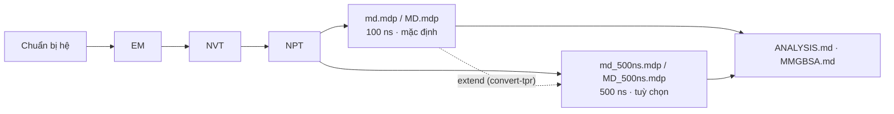

# Tuỳ chọn mở rộng: production 500 ns

Quy trình chung của repo **không đổi**: chuẩn bị hệ → EM → NVT → NPT → production. Mặc định production là **100 ns**. Khi bài báo / reviewer yêu cầu mô phỏng dài hơn, chỉ cần **thay file `.mdp` của bước production** bằng bản 500 ns — mọi bước trước đó và toàn bộ phân tích giữ nguyên.



## File cấu hình

| Hệ | 100 ns (mặc định) | 500 ns (tuỳ chọn) |
|----|-------------------|-------------------|
| Protein–Protein | [`protein-protein/mdp/md.mdp`](../protein-protein/mdp/md.mdp) | [`protein-protein/mdp/md_500ns.mdp`](../protein-protein/mdp/md_500ns.mdp) |
| APO | [`protein-ligand/apo/mdp/MD.mdp`](../protein-ligand/apo/mdp/MD.mdp) | [`protein-ligand/apo/mdp/MD_500ns.mdp`](../protein-ligand/apo/mdp/MD_500ns.mdp) |
| HOLO | [`protein-ligand/holo/mdp/MD.mdp`](../protein-ligand/holo/mdp/MD.mdp) | [`protein-ligand/holo/mdp/MD_500ns.mdp`](../protein-ligand/holo/mdp/MD_500ns.mdp) |

Bản 500 ns giống hệt bản 100 ns về vật lý (force field, nhiệt độ, áp suất, cutoff, thermostat, barostat). Chỉ khác **số bước** và **tần suất ghi output** để file không quá lớn:

| Tham số | PRO–PRO 100 ns | PRO–PRO 500 ns | APO/HOLO 100 ns | APO/HOLO 500 ns |
|---------|---------------:|---------------:|----------------:|----------------:|
| `nsteps` (dt = 2 fs) | 50 000 000 | **250 000 000** | 50 000 000 | **250 000 000** |
| `nstxout-compressed` | 5 000 (10 ps) | **50 000 (100 ps)** | 10 000 (20 ps) | **50 000 (100 ps)** |
| `nstenergy` / `nstlog` | 5 000 (10 ps) | 5 000 (10 ps) | 1 000 (2 ps) | **5 000 (10 ps)** |
| Số frame trajectory | 10 000 | 5 000 | 5 000 | 5 000 |

> Cần độ phân giải thời gian cao hơn (ví dụ autocorrelation của H-bond ở thang ps)? Giảm `nstxout-compressed` về 10 000 (20 ps) — trajectory sẽ lớn gấp 5 lần.

## Cách chạy

### A. Chạy 500 ns ngay từ đầu

Chỉ đổi file ở bước production của guide:

```bash
# APO / HOLO
gmx grompp -f MD_500ns.mdp -c npt.gro -t npt.cpt -p topol.top -n index.ndx -o md_0_500.tpr
gmx mdrun -deffnm md_0_500

# Protein–Protein
gmx grompp -c npt.gro -t npt.cpt -f md_500ns.mdp -o md.tpr -p LM.top -n index.ndx -maxwarn 5
gmx mdrun -s md.tpr -o md.trr -c 3bik_md.pdb -g md.log -e md.edr -cpo md.cpt
```

Hoặc dùng pipeline tự động (máy local hoặc RunPod):

```bash
bash runpod/run_md.sh --system holo --length 500 --workdir path/to/my_complex
```

### B. Đã có 100 ns, kéo dài lên 500 ns (không chạy lại)

```bash
gmx convert-tpr -s md_0_10.tpr -until 500000 -o md_0_500.tpr     # -until tính bằng ps
gmx mdrun -s md_0_500.tpr -cpi md_0_10.cpt -deffnm md_0_10        # nối tiếp vào md_0_10.xtc/.edr/.log
```

hoặc: `bash runpod/extend_md.sh --workdir path/to/run --to 500` (với output của `run_md.sh`).

Phần kéo dài giữ **tần suất ghi của run 100 ns** (không đổi được bằng `convert-tpr`).

### C. Chạy theo đoạn (máy có giới hạn thời gian / bị ngắt)

`mdrun` ghi checkpoint mỗi 15 phút (`-cpt 15`). Nếu bị dừng giữa chừng:

```bash
gmx mdrun -deffnm md_0_500 -cpi md_0_500.cpt          # tiếp tục, nối vào file cũ
```

Có thể giới hạn mỗi lần chạy, ví dụ 23 giờ: thêm `-maxh 23`.

## Thời gian và dung lượng

Thời gian ≈ `500 / (ns/day)` ngày. Đọc ns/day thật ở cuối `md.log` của một run ngắn (dòng `Performance:`), hoặc dùng `runpod/benchmark.sh`.

| Tốc độ | 100 ns | 500 ns |
|-------:|-------:|-------:|
| 50 ns/day | 2 ngày | 10 ngày |
| 100 ns/day | 1 ngày | 5 ngày |
| 200 ns/day | 12 giờ | 2,5 ngày |
| 400 ns/day | 6 giờ | 1,25 ngày |

Dung lượng `.xtc` tỉ lệ với *số atom × số frame*. Với 5 000 frame, hệ ~50 000 atom (protein + nước) thường cỡ vài GB. `runpod/pack_results.sh` tạo bản **không có nước** nhỏ hơn nhiều để tải về và phân tích.

Nếu máy local quá chậm: xem [runpod/README.md](../runpod/README.md).

## Phân tích run 500 ns

Mọi lệnh trong [ANALYSIS.md](../protein-ligand/ANALYSIS.md) và [protein-protein](../protein-protein/README.md#9-phân-tích) dùng được nguyên vẹn (`-tu ns` đã có sẵn). Một số gợi ý thêm:

- **Đoạn cân bằng:** xác định từ RMSD (thường bỏ 50–100 ns đầu) và báo cáo trung bình trên đoạn ổn định, ví dụ `gmx rms ... -b 100000` (ps).
- **MM/GBSA:** không cần tất cả frame. Trong `mmpbsa.in` đặt `startframe` / `endframe` / `interval` để lấy ~200–500 frame đều trong đoạn ổn định.
- **Replica:** 3 × 500 ns độc lập (seed khác nhau) thuyết phục hơn 1 run dài — xem [runpod/README.md#chạy-nhiều-replica](../runpod/README.md#chạy-nhiều-replica).
