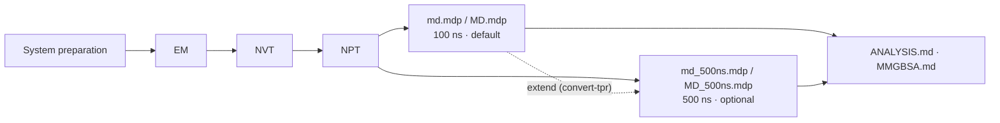

# Extended option: 500 ns production

The repository's general workflow **does not change**: system preparation → EM → NVT → NPT → production. Production defaults to **100 ns**. When a journal or reviewer asks for longer simulations, only **the production `.mdp` file is swapped** for the 500 ns version — every earlier step and all analyses stay the same.



## Parameter files

| System | 100 ns (default) | 500 ns (optional) |
|--------|------------------|-------------------|
| Protein–Protein | [`protein-protein/mdp/md.mdp`](../protein-protein/mdp/md.mdp) | [`protein-protein/mdp/md_500ns.mdp`](../protein-protein/mdp/md_500ns.mdp) |
| APO | [`protein-ligand/apo/mdp/MD.mdp`](../protein-ligand/apo/mdp/MD.mdp) | [`protein-ligand/apo/mdp/MD_500ns.mdp`](../protein-ligand/apo/mdp/MD_500ns.mdp) |
| HOLO | [`protein-ligand/holo/mdp/MD.mdp`](../protein-ligand/holo/mdp/MD.mdp) | [`protein-ligand/holo/mdp/MD_500ns.mdp`](../protein-ligand/holo/mdp/MD_500ns.mdp) |

The 500 ns files are physically identical to the 100 ns files (force field, temperature, pressure, cut-offs, thermostat, barostat). Only the **number of steps** and the **output frequency** differ, to keep the files manageable:

| Parameter | PRO–PRO 100 ns | PRO–PRO 500 ns | APO/HOLO 100 ns | APO/HOLO 500 ns |
|-----------|---------------:|---------------:|----------------:|----------------:|
| `nsteps` (dt = 2 fs) | 50 000 000 | **250 000 000** | 50 000 000 | **250 000 000** |
| `nstxout-compressed` | 5 000 (10 ps) | **50 000 (100 ps)** | 10 000 (20 ps) | **50 000 (100 ps)** |
| `nstenergy` / `nstlog` | 5 000 (10 ps) | 5 000 (10 ps) | 1 000 (2 ps) | **5 000 (10 ps)** |
| Trajectory frames | 10 000 | 5 000 | 5 000 | 5 000 |

> Need finer time resolution (e.g. H-bond autocorrelation on the ps scale)? Set `nstxout-compressed` back to 10 000 (20 ps) — the trajectory becomes 5× larger.

## How to run

### A. Run 500 ns from the start

Only the file used in the production step of the guide changes:

```bash
# APO / HOLO
gmx grompp -f MD_500ns.mdp -c npt.gro -t npt.cpt -p topol.top -n index.ndx -o md_0_500.tpr
gmx mdrun -deffnm md_0_500

# Protein–Protein
gmx grompp -c npt.gro -t npt.cpt -f md_500ns.mdp -o md.tpr -p LM.top -n index.ndx -maxwarn 5
gmx mdrun -s md.tpr -o md.trr -c 3bik_md.pdb -g md.log -e md.edr -cpo md.cpt
```

Or use the automated pipeline (workstation or RunPod):

```bash
bash runpod/run_md.sh --system holo --length 500 --workdir path/to/my_complex
```

### B. Extend an existing 100 ns run to 500 ns (no restart)

```bash
gmx convert-tpr -s md_0_10.tpr -until 500000 -o md_0_500.tpr     # -until is in ps
gmx mdrun -s md_0_500.tpr -cpi md_0_10.cpt -deffnm md_0_10        # appends to md_0_10.xtc/.edr/.log
```

or: `bash runpod/extend_md.sh --workdir path/to/run --to 500` (for runs made with `run_md.sh`).

The extension keeps **the output frequency of the 100 ns run** (it cannot be changed with `convert-tpr`).

### C. Run in segments (time-limited machines / interruptions)

`mdrun` writes a checkpoint every 15 minutes (`-cpt 15`). If a run stops part-way:

```bash
gmx mdrun -deffnm md_0_500 -cpi md_0_500.cpt          # continue, appending to the existing files
```

To limit each session, e.g. to 23 hours, add `-maxh 23`.

## Run time and disk space

Run time ≈ `500 / (ns/day)` days. Read the real ns/day at the end of `md.log` of a short run (line `Performance:`), or use `runpod/benchmark.sh`.

| Speed | 100 ns | 500 ns |
|------:|-------:|-------:|
| 50 ns/day | 2 days | 10 days |
| 100 ns/day | 1 day | 5 days |
| 200 ns/day | 12 hours | 2.5 days |
| 400 ns/day | 6 hours | 1.25 days |

The size of the `.xtc` scales with *number of atoms × number of frames*. With 5 000 frames, a system of ~50 000 atoms (protein + water) is typically a few GB. `runpod/pack_results.sh` writes a much smaller **water-free** copy for download and analysis.

If your workstation is too slow: see [runpod/README.md](../runpod/README.md).

## Analysing a 500 ns run

Every command in [ANALYSIS.md](../protein-ligand/ANALYSIS.md) and in the [protein–protein guide](../protein-protein/README.md#9-analysis) works unchanged (`-tu ns` is already set). Some extra tips:

- **Equilibrated window:** determine it from the RMSD (often the first 50–100 ns are discarded) and report averages over the stable part, e.g. `gmx rms ... -b 100000` (ps).
- **MM/GBSA:** not every frame is needed. In `mmpbsa.in`, set `startframe` / `endframe` / `interval` to use ~200–500 evenly spaced frames from the stable window.
- **Replicas:** 3 × 500 ns independent runs (different seeds) are more convincing than one long run — see [runpod/README.md#running-replicas](../runpod/README.md#running-replicas).
