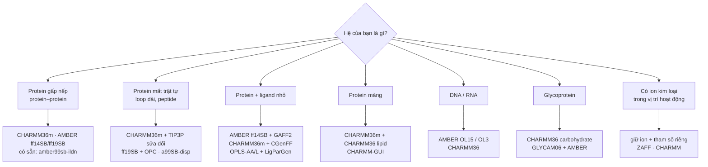

# Chọn force field cho đúng mục đích

Force field (FF) quyết định "vật lý" của mô phỏng. Chọn sai FF — hoặc ghép FF, mô hình nước và tham số ligand không cùng họ — là nguyên nhân phổ biến nhất khiến kết quả MD không đáng tin, dù mọi bước kỹ thuật đều chạy được.

- [1. Năm nguyên tắc](#1-năm-nguyên-tắc)
- [2. Chọn theo mục đích và loại cấu trúc](#2-chọn-theo-mục-đích-và-loại-cấu-trúc)
- [3. Mô hình nước đi kèm](#3-mô-hình-nước-đi-kèm)
- [4. Tham số hoá ligand cùng họ](#4-tham-số-hoá-ligand-cùng-họ)
- [5. Thiết lập nonbonded trong `.mdp` theo FF](#5-thiết-lập-nonbonded-trong-mdp-theo-ff)
- [6. Force field có sẵn và cách dùng FF ngoài](#6-force-field-có-sẵn-và-cách-dùng-ff-ngoài)
- [7. Cấu hình hiện tại của repo](#7-cấu-hình-hiện-tại-của-repo)

---

## 1. Năm nguyên tắc

1. **Chọn theo hệ và câu hỏi khoa học**, không theo thói quen: protein gấp nếp, protein mất trật tự (IDP), màng, DNA/RNA, glycan, kim loại… mỗi loại có FF được kiểm chứng tốt nhất.
2. **Nước đi theo FF**: mỗi FF được tham số hoá cùng một mô hình nước cụ thể (mục 3).
3. **Ligand cùng họ với protein**: CHARMM ↔ CGenFF, AMBER ↔ GAFF2, OPLS ↔ LigParGen, GROMOS ↔ ATB (mục 4). **Không** trộn CHARMM protein với ligand OPLS.
4. **`.mdp` theo FF**: cutoff, kiểu cắt van der Waals và `DispCorr` là một phần của FF, không phải tuỳ chọn tự do (mục 5).
5. **Giữ nguyên trong cả nghiên cứu**: khi so sánh APO/HOLO, các ligand, các biến thể hay replica — cùng FF, cùng nước, cùng `.mdp`. Khi muốn tái lập một bài đã công bố — dùng đúng FF của bài đó.

---

## 2. Chọn theo mục đích và loại cấu trúc



| Mục đích / cấu trúc | Lựa chọn tốt | Ghi chú |
|---------------------|--------------|---------|
| **Protein gấp nếp, ổn định cấu trúc, protein–protein interface** | **CHARMM36m**, **AMBER ff14SB** hoặc **ff19SB**; có sẵn trong GROMACS: **amber99sb-ildn** | Các FF all-atom hiện đại cho kết quả tương đương nhau với protein gấp nếp. amber99sb-ildn là lựa chọn "có sẵn" tốt nhất trong bản cài GROMACS. |
| **IDP, peptide ngắn, loop dài linh động** | **CHARMM36m** (+ CHARMM TIP3P có chỉnh LJ của H), **ff19SB + OPC**, **a99SB-disp** | FF cũ + TIP3P thường làm IDP co cụm quá mức; dùng FF được hiệu chỉnh cho IDP. |
| **Protein–ligand sau docking, MM/GBSA** | **AMBER ff14SB + GAFF2** (thuận tiện nhất cho gmx_MMPBSA), **CHARMM36m + CGenFF**, **OPLS-AA/L + LigParGen** | Quan trọng nhất là ligand và protein cùng họ. Khi xếp hạng nhiều ligand, giữ cùng một cách tính điện tích. |
| **Protein màng** | **CHARMM36m + CHARMM36 lipids** (CHARMM-GUI Membrane Builder) · AMBER **Lipid21** | Dựng màng bằng CHARMM-GUI, chọn đầu ra GROMACS; `.mdp` theo khuyến nghị của CHARMM-GUI. |
| **DNA / RNA, protein–nucleic acid** | AMBER **OL15** (DNA), **OL3** (RNA) cùng ff14SB; **CHARMM36** | Không dùng FF chỉ dành cho protein. |
| **Glycoprotein, glycan** | **CHARMM36** carbohydrate (CHARMM-GUI Glycan Reader) · **GLYCAM06** + AMBER | |
| **Có Zn²⁺/Mg²⁺/Fe trong vị trí hoạt động** | Giữ ion; dùng mô hình tham số riêng (ví dụ **ZAFF** cho Zn với AMBER) | Chỉ được bỏ ion (như ghi chú trong guide PRO–PRO) khi ion **không** tham gia cấu trúc/chức năng ở vùng nghiên cứu. Zinc finger, metalloenzyme thì không được bỏ. |
| **Tái lập một bài đã công bố** | Đúng FF + nước + `.mdp` của bài đó | Ví dụ protocol PRO–PRO của repo dùng **GROMOS 45a3 + SPC** để khớp Yang & Tseng (2023). |
| **Hệ rất lớn / cần sampling dài với tài nguyên hạn chế** | **GROMOS 54a7** (united-atom, ít atom hơn) hoặc coarse-grained **Martini 3** | Martini là quy trình khác hẳn (không dùng các guide này). |

---

## 3. Mô hình nước đi kèm

| Force field | Nước khuyến nghị | `-water` trong pdb2gmx | Hộp nước cho `gmx solvate` |
|-------------|------------------|------------------------|-----------------------------|
| CHARMM36 / 36m | CHARMM TIP3P (TIPS3P, có LJ trên H) | `tip3p` (bản port CHARMM dùng TIP3P kiểu CHARMM) | `spc216.gro` |
| AMBER ff14SB, amber99sb-ildn | TIP3P | `tip3p` | `spc216.gro` |
| AMBER ff19SB | **OPC** (4 điểm) | cần file OPC đi kèm bản port | theo bản port |
| OPLS-AA/L | TIP4P (gốc) hoặc TIP3P (phổ biến) | `tip4p` / `tip3p` | `tip4p.gro` / `spc216.gro` |
| GROMOS 54a7 / 45a3 | **SPC** (hoặc SPC/E) | `spc` | `spc216.gro` |

`spc216.gro` chỉ là toạ độ cân bằng sẵn của nước 3 điểm; dùng được cho SPC, SPC/E và TIP3P. Nước 4 điểm (TIP4P, OPC) cần hộp nước 4 điểm.

---

## 4. Tham số hoá ligand cùng họ

| Protein FF | Ligand FF | Công cụ | Điện tích |
|------------|-----------|---------|-----------|
| CHARMM36m | **CGenFF** | CHARMM-GUI Ligand Reader & Modeler, hoặc server CGenFF + `cgenff_charmm2gmx.py` | CGenFF (xem "penalty score": penalty cao → cần tối ưu thêm) |
| AMBER ff14SB / ff19SB | **GAFF2** | `antechamber` + `parmchk2` (AmberTools), chuyển sang GROMACS bằng **ACPYPE** | AM1-BCC (`-c bcc`) |
| OPLS-AA/L | **OPLS-AA** | **LigParGen** (web) | 1.14×CM1A (ligand trung hoà) hoặc CM1A-LBCC |
| GROMOS 54a7 | GROMOS | **ATB** — Automated Topology Builder (web) | ATB |

Lưu ý chung:
- **Proton hoá đúng pH** (thường 7.4) trước khi tham số hoá: thêm H bằng Chimera/OpenBabel, kiểm tra nhóm amin, carboxyl, imidazole.
- Nhập **điện tích tổng** đúng (`-nc` của antechamber); ligand mang điện thường cần thêm ion đối trọng — `genion -neutral` sẽ lo.
- Giữ **toạ độ docking**: kiểm tra ligand sau tham số hoá không bị dịch chuyển (`prepare_system.sh` tự kiểm tra khoảng dịch tâm ligand).
- MM/GBSA với gmx_MMPBSA chạy ổn định nhất khi hệ là AMBER + GAFF2. Với OPLS/CHARMM, đôi khi cần dựng topology Amber cho ligand (xem [TROUBLESHOOTING.md](TROUBLESHOOTING.md#3-gmx_mmpbsa-chamberparm-error)).

---

## 5. Thiết lập nonbonded trong `.mdp` theo FF

Thay khối nonbonded trong **tất cả** các file `.mdp` (EM, NVT, NPT, MD) khi đổi FF.

**CHARMM36 / 36m** (theo khuyến nghị của tài liệu GROMACS cho CHARMM):

```ini
cutoff-scheme   = Verlet
coulombtype     = PME
rcoulomb        = 1.2
vdwtype         = cutoff
vdw-modifier    = force-switch
rvdw-switch     = 1.0
rvdw            = 1.2
DispCorr        = no
constraints     = h-bonds
```

**AMBER (ff14SB, ff19SB, amber99sb-ildn)** và **OPLS-AA/L**:

```ini
cutoff-scheme   = Verlet
coulombtype     = PME
rcoulomb        = 1.0          ; 1.0–1.2
vdwtype         = cutoff
vdw-modifier    = potential-shift
rvdw            = 1.0          ; = rcoulomb
DispCorr        = EnerPres
constraints     = h-bonds
```

**GROMOS 54a7 / 45a3** (tham số hoá với cutoff dài):

```ini
cutoff-scheme   = Verlet
coulombtype     = PME          ; bài gốc dùng reaction-field
rcoulomb        = 1.4
vdwtype         = cutoff
vdw-modifier    = potential-shift
rvdw            = 1.4
DispCorr        = EnerPres
constraints     = h-bonds
```

> GROMACS luôn cảnh báo khi dùng GROMOS ("parametrized with a physically incorrect multiple-time-stepping scheme"). Đó là cảnh báo đã biết — vì vậy guide PRO–PRO và `run_md.sh --system pp` dùng `-maxwarn 1`. Mọi cảnh báo khác vẫn phải đọc kỹ.

Phần còn lại (thermostat, barostat, `dt = 2 fs` với `constraints = h-bonds`) dùng chung cho mọi FF all-atom.

---

## 6. Force field có sẵn và cách dùng FF ngoài

**Có sẵn trong GROMACS 2023** (tên dùng cho `pdb2gmx -ff` hoặc `prepare_system.sh --ff`):

| Họ | Tên |
|----|-----|
| AMBER | `amber03`, `amber94`, `amber96`, `amber99`, `amber99sb`, **`amber99sb-ildn`**, `amberGS` |
| CHARMM | `charmm27` (cũ — nên dùng CHARMM36m bản port) |
| GROMOS | `gromos43a1`, `gromos43a2`, **`gromos45a3`**, `gromos53a5`, `gromos53a6`, **`gromos54a7`** |
| OPLS | **`oplsaa`** (OPLS-AA/L) |

**Dùng FF không có sẵn** (CHARMM36m, AMBER ff14SB/ff19SB): tải bản port cho GROMACS (ví dụ `charmm36-jul2022.ff` từ trang MacKerell lab), giải nén **vào thư mục làm việc**, rồi:

```bash
# thư mục my_complex/ chứa charmm36-jul2022.ff/
bash scripts/prepare_system.sh --system apo --pdb protein.pdb --workdir my_complex \
     --ff charmm36-jul2022 --water tip3p
```

`pdb2gmx` tự tìm các thư mục `*.ff` trong thư mục hiện tại. `run_md.sh --quick-test` cũng copy các thư mục `*.ff` đi kèm. Nhớ sửa khối nonbonded của các `.mdp` theo mục 5.

---

## 7. Cấu hình hiện tại của repo

| Track | FF + nước | Ligand | `.mdp` nonbonded | Nhận xét |
|-------|-----------|--------|------------------|----------|
| Protein–Protein | GROMOS 45a3 + SPC | — | PME, 1.0 nm, `EnerPres` | Khớp protocol Yang & Tseng (2023) để so sánh với bài đó. Với nghiên cứu mới, cân nhắc CHARMM36m hoặc amber99sb-ildn; nếu giữ GROMOS, dùng cutoff 1.4 nm (mục 5). |
| Protein–Ligand (APO/HOLO) | OPLS-AA/L + TIP3P | LigParGen (OPLS-AA) | PME, 1.2 nm, `force-switch`, `DispCorr = no` (kiểu CHARMM) | Protein–ligand cùng họ OPLS ✔. Khối nonbonded hiện là kiểu CHARMM; với OPLS nên dùng khối AMBER/OPLS ở mục 5, **hoặc** chuyển cả hệ sang CHARMM36m + CGenFF để giữ nguyên `.mdp`. Dù chọn cách nào, giữ giống nhau cho APO và HOLO. |

---

## Tham khảo

- Huang J. et al. *CHARMM36m: an improved force field for folded and intrinsically disordered proteins.* Nat. Methods 14, 71–73 (2017).
- Maier J. A. et al. *ff14SB: improving the accuracy of protein side chain and backbone parameters from ff99SB.* J. Chem. Theory Comput. 11, 3696–3713 (2015).
- Tian C. et al. *ff19SB: amino-acid-specific protein backbone parameters trained against quantum mechanics energy surfaces in solution.* J. Chem. Theory Comput. 16, 528–552 (2020).
- Lindorff-Larsen K. et al. *Improved side-chain torsion potentials for the Amber ff99SB protein force field.* Proteins 78, 1950–1958 (2010). (amber99sb-ildn)
- Robustelli P., Piana S., Shaw D. E. *Developing a molecular dynamics force field for both folded and disordered protein states.* PNAS 115, E4758–E4766 (2018). (a99SB-disp)
- Schmid N. et al. *Definition and testing of the GROMOS force-field versions 54A7 and 54B7.* Eur. Biophys. J. 40, 843–856 (2011).
- Vanommeslaeghe K. et al. *CHARMM General Force Field (CGenFF).* J. Comput. Chem. 31, 671–690 (2010).
- Dodda L. S. et al. *LigParGen web server.* Nucleic Acids Res. 45, W331–W336 (2017).
- Malde A. K. et al. *An Automated Force Field Topology Builder (ATB) and Repository.* J. Chem. Theory Comput. 7, 4026–4037 (2011).
- GROMACS manual — *Force fields in GROMACS* (CHARMM / AMBER / GROMOS / OPLS notes): https://manual.gromacs.org/current/user-guide/force-fields.html
