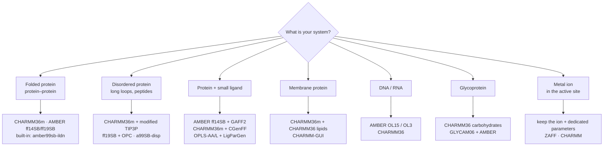

# Choosing the right force field

The force field (FF) defines the "physics" of a simulation. Choosing the wrong FF — or combining an FF, a water model and ligand parameters from different families — is the most common reason why MD results are unreliable even when every technical step runs without errors.

- [1. Five principles](#1-five-principles)
- [2. Choosing by purpose and structure type](#2-choosing-by-purpose-and-structure-type)
- [3. Matching water models](#3-matching-water-models)
- [4. Ligand parameters from the same family](#4-ligand-parameters-from-the-same-family)
- [5. Nonbonded `.mdp` settings per force field](#5-nonbonded-mdp-settings-per-force-field)
- [6. Built-in force fields and using external ones](#6-built-in-force-fields-and-using-external-ones)
- [7. Current configuration of this repository](#7-current-configuration-of-this-repository)

---

## 1. Five principles

1. **Choose by system and scientific question**, not by habit: folded proteins, intrinsically disordered proteins (IDPs), membranes, DNA/RNA, glycans, metals… each has FFs that are best validated for it.
2. **The water model follows the FF**: every FF is parameterised together with a specific water model (section 3).
3. **Ligand and protein from the same family**: CHARMM ↔ CGenFF, AMBER ↔ GAFF2, OPLS ↔ LigParGen, GROMOS ↔ ATB (section 4). **Never** mix a CHARMM protein with an OPLS ligand.
4. **`.mdp` settings follow the FF**: the cut-off, the van der Waals cut-off treatment and `DispCorr` are part of the FF, not free options (section 5).
5. **Keep it fixed within a study**: when comparing APO/HOLO, ligands, variants or replicas — same FF, same water, same `.mdp`. When reproducing a published study — use exactly its FF.

---

## 2. Choosing by purpose and structure type



| Purpose / structure | Good choices | Notes |
|---------------------|--------------|-------|
| **Folded proteins, structural stability, protein–protein interfaces** | **CHARMM36m**, **AMBER ff14SB** or **ff19SB**; built into GROMACS: **amber99sb-ildn** | Modern all-atom FFs perform similarly for folded proteins. amber99sb-ildn is the best "built-in" choice in a standard GROMACS installation. |
| **IDPs, short peptides, long flexible loops** | **CHARMM36m** (+ CHARMM TIP3P with modified H Lennard-Jones), **ff19SB + OPC**, **a99SB-disp** | Older FFs with plain TIP3P tend to make IDPs too compact; use an FF corrected for disordered proteins. |
| **Protein–ligand after docking, MM/GBSA** | **AMBER ff14SB + GAFF2** (most convenient for gmx_MMPBSA), **CHARMM36m + CGenFF**, **OPLS-AA/L + LigParGen** | Most important: ligand and protein from the same family. When ranking several ligands, use the same charge method for all of them. |
| **Membrane proteins** | **CHARMM36m + CHARMM36 lipids** (CHARMM-GUI Membrane Builder) · AMBER **Lipid21** | Build the membrane with CHARMM-GUI, choose GROMACS output, and use the `.mdp` settings CHARMM-GUI recommends. |
| **DNA / RNA, protein–nucleic acid** | AMBER **OL15** (DNA), **OL3** (RNA) with ff14SB; **CHARMM36** | Do not use protein-only FFs. |
| **Glycoproteins, glycans** | **CHARMM36** carbohydrates (CHARMM-GUI Glycan Reader) · **GLYCAM06** + AMBER | |
| **Zn²⁺ / Mg²⁺ / Fe in the active site** | Keep the ion; use a dedicated parameter model (e.g. **ZAFF** for Zn with AMBER) | Removing the ion (as noted in the protein–protein guide) is only acceptable when it plays **no** structural or functional role in the studied region. Zinc fingers and metalloenzymes must keep it. |
| **Reproducing a published study** | Exactly its FF + water + `.mdp` | E.g. the repository's protein–protein protocol uses **GROMOS 45a3 + SPC** to match Yang & Tseng (2023). |
| **Very large systems / long sampling with limited compute** | **GROMOS 54a7** (united-atom, fewer atoms) or coarse-grained **Martini 3** | Martini is a completely different workflow (not covered by these guides). |

---

## 3. Matching water models

| Force field | Recommended water | `-water` in pdb2gmx | Box for `gmx solvate` |
|-------------|-------------------|---------------------|------------------------|
| CHARMM36 / 36m | CHARMM TIP3P (TIPS3P, with LJ on H) | `tip3p` (the CHARMM port provides the CHARMM variant) | `spc216.gro` |
| AMBER ff14SB, amber99sb-ildn | TIP3P | `tip3p` | `spc216.gro` |
| AMBER ff19SB | **OPC** (4-site) | requires the OPC files of the port | as provided by the port |
| OPLS-AA/L | TIP4P (original) or TIP3P (common) | `tip4p` / `tip3p` | `tip4p.gro` / `spc216.gro` |
| GROMOS 54a7 / 45a3 | **SPC** (or SPC/E) | `spc` | `spc216.gro` |

`spc216.gro` is just a pre-equilibrated box of 3-site water; it works for SPC, SPC/E and TIP3P. 4-site water (TIP4P, OPC) needs a 4-site water box.

---

## 4. Ligand parameters from the same family

| Protein FF | Ligand FF | Tool | Charges |
|------------|-----------|------|---------|
| CHARMM36m | **CGenFF** | CHARMM-GUI Ligand Reader & Modeler, or the CGenFF server + `cgenff_charmm2gmx.py` | CGenFF (check the penalty scores: high penalties → further optimisation needed) |
| AMBER ff14SB / ff19SB | **GAFF2** | `antechamber` + `parmchk2` (AmberTools), converted to GROMACS with **ACPYPE** | AM1-BCC (`-c bcc`) |
| OPLS-AA/L | **OPLS-AA** | **LigParGen** (web) | 1.14×CM1A (neutral ligands) or CM1A-LBCC |
| GROMOS 54a7 | GROMOS | **ATB** — Automated Topology Builder (web) | ATB |

General notes:
- **Protonate at the right pH** (usually 7.4) before parameterisation: add hydrogens with Chimera / OpenBabel and check amines, carboxylates and imidazoles.
- Give the correct **net charge** (`-nc` in antechamber); charged ligands need counter-ions — `genion -neutral` takes care of that.
- Keep the **docked coordinates**: check that the ligand did not move during parameterisation (`prepare_system.sh` checks the shift of the ligand centre automatically).
- MM/GBSA with gmx_MMPBSA is most robust for AMBER + GAFF2 systems. With OPLS / CHARMM, you sometimes need an Amber topology for the ligand (see [TROUBLESHOOTING.md](TROUBLESHOOTING.md#3-gmx_mmpbsa-chamberparm-error)).

---

## 5. Nonbonded `.mdp` settings per force field

When you change the FF, replace the nonbonded block in **all** `.mdp` files (EM, NVT, NPT, MD).

**CHARMM36 / 36m** (as recommended in the GROMACS documentation for CHARMM):

```ini
cutoff-scheme   = Verlet
coulombtype     = PME
rcoulomb        = 1.2
vdwtype         = cutoff
vdw-modifier    = force-switch
rvdw-switch     = 1.0
rvdw            = 1.2
DispCorr        = no
constraints     = h-bonds
```

**AMBER (ff14SB, ff19SB, amber99sb-ildn)** and **OPLS-AA/L**:

```ini
cutoff-scheme   = Verlet
coulombtype     = PME
rcoulomb        = 1.0          ; 1.0–1.2
vdwtype         = cutoff
vdw-modifier    = potential-shift
rvdw            = 1.0          ; = rcoulomb
DispCorr        = EnerPres
constraints     = h-bonds
```

**GROMOS 54a7 / 45a3** (parameterised with long cut-offs):

```ini
cutoff-scheme   = Verlet
coulombtype     = PME          ; the original parameterisation used reaction-field
rcoulomb        = 1.4
vdwtype         = cutoff
vdw-modifier    = potential-shift
rvdw            = 1.4
DispCorr        = EnerPres
constraints     = h-bonds
```

> GROMACS always warns when GROMOS is used ("parametrized with a physically incorrect multiple-time-stepping scheme"). This is a known warning — that is why the protein–protein guide and `run_md.sh --system pp` use `-maxwarn 1`. Any other warning must still be read carefully.

Everything else (thermostat, barostat, `dt = 2 fs` with `constraints = h-bonds`) is shared by all all-atom FFs.

---

## 6. Built-in force fields and using external ones

**Built into GROMACS 2023** (names for `pdb2gmx -ff` or `prepare_system.sh --ff`):

| Family | Names |
|--------|-------|
| AMBER | `amber03`, `amber94`, `amber96`, `amber99`, `amber99sb`, **`amber99sb-ildn`**, `amberGS` |
| CHARMM | `charmm27` (old — prefer a CHARMM36m port) |
| GROMOS | `gromos43a1`, `gromos43a2`, **`gromos45a3`**, `gromos53a5`, `gromos53a6`, **`gromos54a7`** |
| OPLS | **`oplsaa`** (OPLS-AA/L) |

**Using an FF that is not built in** (CHARMM36m, AMBER ff14SB/ff19SB): download its GROMACS port (e.g. `charmm36-jul2022.ff` from the MacKerell lab website), unpack it **into the working directory**, then:

```bash
# my_complex/ contains charmm36-jul2022.ff/
bash scripts/prepare_system.sh --system apo --pdb protein.pdb --workdir my_complex \
     --ff charmm36-jul2022 --water tip3p
```

`pdb2gmx` finds `*.ff` folders in the current directory automatically, and `run_md.sh --quick-test` copies them along. Remember to update the nonbonded block of the `.mdp` files (section 5).

---

## 7. Current configuration of this repository

| Track | FF + water | Ligand | `.mdp` nonbonded | Comment |
|-------|------------|--------|------------------|---------|
| Protein–Protein | GROMOS 45a3 + SPC | — | PME, 1.0 nm, `EnerPres` | Matches the Yang & Tseng (2023) protocol for comparison with that study. For new work, consider CHARMM36m or amber99sb-ildn; if you keep GROMOS, use 1.4 nm cut-offs (section 5). |
| Protein–Ligand (APO/HOLO) | OPLS-AA/L + TIP3P | LigParGen (OPLS-AA) | PME, 1.2 nm, `force-switch`, `DispCorr = no` (CHARMM style) | Protein and ligand from the same OPLS family ✔. The nonbonded block is currently CHARMM style; for OPLS, use the AMBER/OPLS block from section 5, **or** move the whole system to CHARMM36m + CGenFF to keep the current `.mdp` files. Either way, keep APO and HOLO identical. |

---

## References

- Huang J. et al. *CHARMM36m: an improved force field for folded and intrinsically disordered proteins.* Nat. Methods 14, 71–73 (2017).
- Maier J. A. et al. *ff14SB: improving the accuracy of protein side chain and backbone parameters from ff99SB.* J. Chem. Theory Comput. 11, 3696–3713 (2015).
- Tian C. et al. *ff19SB: amino-acid-specific protein backbone parameters trained against quantum mechanics energy surfaces in solution.* J. Chem. Theory Comput. 16, 528–552 (2020).
- Lindorff-Larsen K. et al. *Improved side-chain torsion potentials for the Amber ff99SB protein force field.* Proteins 78, 1950–1958 (2010). (amber99sb-ildn)
- Robustelli P., Piana S., Shaw D. E. *Developing a molecular dynamics force field for both folded and disordered protein states.* PNAS 115, E4758–E4766 (2018). (a99SB-disp)
- Schmid N. et al. *Definition and testing of the GROMOS force-field versions 54A7 and 54B7.* Eur. Biophys. J. 40, 843–856 (2011).
- Vanommeslaeghe K. et al. *CHARMM General Force Field (CGenFF).* J. Comput. Chem. 31, 671–690 (2010).
- Dodda L. S. et al. *LigParGen web server.* Nucleic Acids Res. 45, W331–W336 (2017).
- Malde A. K. et al. *An Automated Force Field Topology Builder (ATB) and Repository.* J. Chem. Theory Comput. 7, 4026–4037 (2011).
- GROMACS manual — *Force fields in GROMACS*: https://manual.gromacs.org/current/user-guide/force-fields.html
