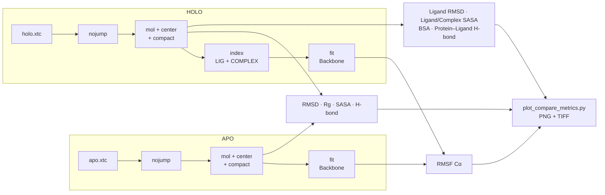

# Post-MD Analysis — APO vs HOLO

Pipeline thống nhất để xử lý trajectory APO và HOLO **theo cùng một cách**, sau đó so sánh trực tiếp bằng [`scripts/plot_compare_metrics.py`](../scripts/plot_compare_metrics.py).

> Quy ước tên file: đổi tên output MD thành `apo.tpr` / `apo.xtc` và `holo.tpr` / `holo.xtc` trước khi chạy các lệnh dưới đây.



---

## A. APO pipeline (Protein)

```bash
# kiểm tra số atom trong xtc
gmx check -f apo.xtc

# PBC: nojump (giữ liên tục theo thời gian)         Output: System
gmx trjconv -s apo.tpr -f apo.xtc -o apo_nojump.xtc -pbc nojump

# PBC: mol + center + compact (trajectory "whole/compact")
gmx trjconv -s apo.tpr -f apo_nojump.xtc -o apo_nopbc.xtc -pbc mol -center -ur compact
# Center: Protein   Output: System

# Fit để dùng cho RMSF
gmx trjconv -s apo.tpr -f apo_nopbc.xtc -o apo_fit.xtc -fit rot+trans
# Fit group: Backbone   Output: Protein
```

> Nếu gặp lỗi mismatch atom, 99% là do chọn Output **System** trong khi `.xtc` chỉ chứa **Protein**.

## B. HOLO pipeline (Protein + Ligand)

```bash
# PBC: nojump                                         Output: System
gmx trjconv -s holo.tpr -f holo.xtc -o holo_nojump.xtc -pbc nojump

# PBC: mol + center + compact
gmx trjconv -s holo.tpr -f holo_nojump.xtc -o holo_nopbc.xtc -pbc mol -center -ur compact
# Center: Protein   Output: System
```

Tạo index cho HOLO: `LIG` + `COMPLEX` (Protein | LIG):

```bash
gmx make_ndx -f holo.tpr -o index_holo.ndx
```

```text
> l                          # liệt kê residue names để chắc resname ligand
> r <LIG_RESNAME>            # ví dụ: r 5315649 hoặc r UNL
> name <id_moi> LIG
> <id_Protein> | <id_LIG>
> name <id_moi> COMPLEX
> q
```

Fit HOLO theo protein (để RMSF "đúng"):

```bash
gmx trjconv -s holo.tpr -f holo_nopbc.xtc -o holo_fit.xtc -fit rot+trans -n index_holo.ndx
# Fit group: Backbone   Output: COMPLEX
```

---

## C. Phân tích (dùng file đã nopbc/fit để đồng nhất)

### Bảng tổng hợp

| # | Chỉ số | Hệ | Lệnh | Chọn nhóm | Output |
|---|--------|----|------|-----------|--------|
| C1.1 | RMSD protein | APO | `gmx rms -s apo.tpr -f apo_nopbc.xtc -o rmsd_apo.xvg -tu ns` | Backbone / Backbone | `rmsd_apo.xvg` |
| C1.2 | RMSD protein | HOLO | `gmx rms -s holo.tpr -f holo_nopbc.xtc -o rmsd_holo.xvg -tu ns -n index_holo.ndx` | Backbone / Backbone | `rmsd_holo.xvg` |
| C1.3 | RMSD ligand (fit theo protein) | HOLO | `gmx rms -s holo.tpr -f holo_nopbc.xtc -o rmsd_lig.xvg -tu ns -n index_holo.ndx` | Backbone / LIG | `rmsd_lig.xvg` |
| C2.1 | RMSF Cα | APO | `gmx rmsf -s apo.tpr -f apo_fit.xtc -o rmsf_apo_at.xvg` | C-alpha | `rmsf_apo_at.xvg` |
| C2.2 | RMSF Cα | HOLO | `gmx rmsf -s holo.tpr -f holo_fit.xtc -o rmsf_holo_at.xvg -n index_holo.ndx` | C-alpha | `rmsf_holo_at.xvg` |
| C3.1 | SASA protein | APO | `gmx sasa -s apo.tpr -f apo_nopbc.xtc -o sasa_protein_apo.xvg -tu ns` | Protein / Protein | `sasa_protein_apo.xvg` |
| C3.2 | SASA protein | HOLO | `gmx sasa -s holo.tpr -f holo_nopbc.xtc -n index_holo.ndx -o sasa_protein_holo.xvg -tu ns` | Protein / Protein | `sasa_protein_holo.xvg` |
| C3.3 | SASA ligand | HOLO | `gmx sasa -s holo.tpr -f holo_nopbc.xtc -n index_holo.ndx -o sasa_lig_holo.xvg -tu ns` | LIG / LIG | `sasa_lig_holo.xvg` |
| C3.4 | SASA complex | HOLO | `gmx sasa -s holo.tpr -f holo_nopbc.xtc -n index_holo.ndx -o sasa_complex_holo.xvg -tu ns` | COMPLEX / COMPLEX | `sasa_complex_holo.xvg` |
| C3.5 | BSA / ΔSASA | HOLO | *script awk bên dưới* | — | `bsa_holo_timeseries.xvg` |
| C4.1 | Rg | APO | `gmx gyrate -s apo.tpr -f apo_nopbc.xtc -o rg_apo.xvg -tu ns` | Protein | `rg_apo.xvg` |
| C4.2 | Rg | HOLO | `gmx gyrate -s holo.tpr -f holo_nopbc.xtc -o rg_holo.xvg -tu ns -n index_holo.ndx` | Protein | `rg_holo.xvg` |
| C5.1 | H-bond nội protein | APO | `gmx hbond -s apo.tpr -f apo_nopbc.xtc -num hb_apo.xvg -tu ns` | Protein / Protein | `hb_apo.xvg` |
| C5.2 | H-bond protein–ligand | HOLO | `gmx hbond -s holo.tpr -f holo_nopbc.xtc -num hb_prot_lig.xvg -tu ns -n index_holo.ndx` | Protein / LIG | `hb_prot_lig.xvg` |

> Với GROMACS 2024+, cú pháp chọn nhóm của `gmx hbond` dùng selection (`-r` / `-t`); cú pháp kiểu cũ ở trên chạy bằng `gmx hbond-legacy`.

### C3.5 Buried Surface Area theo thời gian

$$\mathrm{BSA}(t) = \mathrm{SASA}_{protein}(t) + \mathrm{SASA}_{ligand}(t) - \mathrm{SASA}_{complex}(t)$$

```bash
# lấy đúng 2 cột: time và SASA_total
grep -v '^[#@]' sasa_protein_holo.xvg | awk '{print $1,$2}' > prot.dat
grep -v '^[#@]' sasa_lig_holo.xvg     | awk '{print $1,$2}' > lig.dat
grep -v '^[#@]' sasa_complex_holo.xvg | awk '{print $1,$2}' > cplx.dat

# BSA(t) = Prot(t) + Lig(t) - Complex(t), kèm kiểm tra time khớp nhau
paste prot.dat lig.dat cplx.dat | awk '
BEGIN{OFS="\t"}
($1!=$3 || $1!=$5){print "Time mismatch at line", NR, ":", $1,$3,$5 > "/dev/stderr"; exit 1}
{print $1, $2 + $4 - $6}
' > bsa_holo_timeseries.xvg
```

---

## D. Vẽ hình so sánh

Đặt toàn bộ file `.xvg` ở trên vào một thư mục rồi chạy:

```bash
python scripts/plot_compare_metrics.py --base path/to/xvg --outdir plots --dpi 600
```

| Hình | Dữ liệu |
|------|---------|
| `RMSD_APO_vs_HOLO_plus_Ligand` | `rmsd_apo` · `rmsd_holo` · `rmsd_lig` |
| `RMSF_APO_vs_HOLO` | `rmsf_apo_at` · `rmsf_holo_at` |
| `Rg_APO_vs_HOLO` (hoặc `Rg_HOLO_only`) | `rg_apo` · `rg_holo` |
| `SASA_APO_vs_HOLO` | `sasa_protein_apo` · `sasa_protein_holo` · `sasa_lig_holo` · `sasa_complex_holo` |
| `BSA_HOLO` | `bsa_holo_timeseries` |
| `HBonds_HOLO_prot_lig` | `hb_prot_lig` |

Mỗi hình được lưu đồng thời `.png` và `.tiff` (sẵn sàng cho bài báo). File thiếu sẽ được bỏ qua kèm cảnh báo `[WARN]`.

Đọc và diễn giải kết quả: [docs/MD_results_interpretation.md](../docs/MD_results_interpretation.md).
