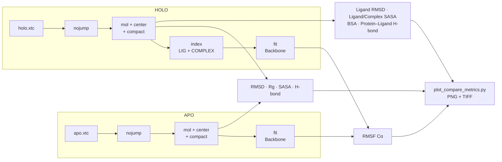

# Post-MD Analysis — APO vs HOLO

A unified pipeline that processes the APO and HOLO trajectories **in exactly the same way**, then compares them directly with [`scripts/plot_compare_metrics.py`](../scripts/plot_compare_metrics.py).

> Naming convention: rename the MD outputs to `apo.tpr` / `apo.xtc` and `holo.tpr` / `holo.xtc` before running the commands below. (The water-free `md_noWater.tpr` / `md_noWater.xtc` written by [`runpod/pack_results.sh`](../runpod/pack_results.sh) work the same way.)



---

## A. APO pipeline (protein)

```bash
# check the number of atoms in the xtc
gmx check -f apo.xtc

# PBC: nojump (keeps molecules continuous in time)          Output: System
gmx trjconv -s apo.tpr -f apo.xtc -o apo_nojump.xtc -pbc nojump

# PBC: mol + center + compact ("whole / compact" trajectory)
gmx trjconv -s apo.tpr -f apo_nojump.xtc -o apo_nopbc.xtc -pbc mol -center -ur compact
# Center: Protein   Output: System

# Fitted trajectory for RMSF
gmx trjconv -s apo.tpr -f apo_nopbc.xtc -o apo_fit.xtc -fit rot+trans
# Fit group: Backbone   Output: Protein
```

> An atom-count mismatch error almost always means **System** was chosen as output while the `.xtc` contains only **Protein**.

## B. HOLO pipeline (protein + ligand)

```bash
# PBC: nojump                                                Output: System
gmx trjconv -s holo.tpr -f holo.xtc -o holo_nojump.xtc -pbc nojump

# PBC: mol + center + compact
gmx trjconv -s holo.tpr -f holo_nojump.xtc -o holo_nopbc.xtc -pbc mol -center -ur compact
# Center: Protein   Output: System
```

Create the HOLO index: `LIG` + `COMPLEX` (Protein | LIG):

```bash
gmx make_ndx -f holo.tpr -o index_holo.ndx
```

```text
> l                          # list residue names to confirm the ligand name
> r <LIG_RESNAME>            # e.g. r 5315649 or r UNL
> name <new_id> LIG
> <id_Protein> | <id_LIG>
> name <new_id> COMPLEX
> q
```

Fit HOLO on the protein (needed for a meaningful RMSF):

```bash
gmx trjconv -s holo.tpr -f holo_nopbc.xtc -o holo_fit.xtc -fit rot+trans -n index_holo.ndx
# Fit group: Backbone   Output: COMPLEX
```

---

## C. Analysis (always on the nopbc / fit trajectories, for consistency)

### Summary table

| # | Metric | System | Command | Groups | Output |
|---|--------|--------|---------|--------|--------|
| C1.1 | Protein RMSD | APO | `gmx rms -s apo.tpr -f apo_nopbc.xtc -o rmsd_apo.xvg -tu ns` | Backbone / Backbone | `rmsd_apo.xvg` |
| C1.2 | Protein RMSD | HOLO | `gmx rms -s holo.tpr -f holo_nopbc.xtc -o rmsd_holo.xvg -tu ns -n index_holo.ndx` | Backbone / Backbone | `rmsd_holo.xvg` |
| C1.3 | Ligand RMSD (fit on protein) | HOLO | `gmx rms -s holo.tpr -f holo_nopbc.xtc -o rmsd_lig.xvg -tu ns -n index_holo.ndx` | Backbone / LIG | `rmsd_lig.xvg` |
| C2.1 | Cα RMSF | APO | `gmx rmsf -s apo.tpr -f apo_fit.xtc -o rmsf_apo_at.xvg` | C-alpha | `rmsf_apo_at.xvg` |
| C2.2 | Cα RMSF | HOLO | `gmx rmsf -s holo.tpr -f holo_fit.xtc -o rmsf_holo_at.xvg -n index_holo.ndx` | C-alpha | `rmsf_holo_at.xvg` |
| C3.1 | Protein SASA | APO | `gmx sasa -s apo.tpr -f apo_nopbc.xtc -o sasa_protein_apo.xvg -tu ns` | Protein / Protein | `sasa_protein_apo.xvg` |
| C3.2 | Protein SASA | HOLO | `gmx sasa -s holo.tpr -f holo_nopbc.xtc -n index_holo.ndx -o sasa_protein_holo.xvg -tu ns` | Protein / Protein | `sasa_protein_holo.xvg` |
| C3.3 | Ligand SASA | HOLO | `gmx sasa -s holo.tpr -f holo_nopbc.xtc -n index_holo.ndx -o sasa_lig_holo.xvg -tu ns` | LIG / LIG | `sasa_lig_holo.xvg` |
| C3.4 | Complex SASA | HOLO | `gmx sasa -s holo.tpr -f holo_nopbc.xtc -n index_holo.ndx -o sasa_complex_holo.xvg -tu ns` | COMPLEX / COMPLEX | `sasa_complex_holo.xvg` |
| C3.5 | BSA / ΔSASA | HOLO | *awk script below* | — | `bsa_holo_timeseries.xvg` |
| C4.1 | Rg | APO | `gmx gyrate -s apo.tpr -f apo_nopbc.xtc -o rg_apo.xvg -tu ns` | Protein | `rg_apo.xvg` |
| C4.2 | Rg | HOLO | `gmx gyrate -s holo.tpr -f holo_nopbc.xtc -o rg_holo.xvg -tu ns -n index_holo.ndx` | Protein | `rg_holo.xvg` |
| C5.1 | Intra-protein H-bonds | APO | `gmx hbond -s apo.tpr -f apo_nopbc.xtc -num hb_apo.xvg -tu ns` | Protein / Protein | `hb_apo.xvg` |
| C5.2 | Protein–ligand H-bonds | HOLO | `gmx hbond -s holo.tpr -f holo_nopbc.xtc -num hb_prot_lig.xvg -tu ns -n index_holo.ndx` | Protein / LIG | `hb_prot_lig.xvg` |

> In GROMACS 2024+, `gmx hbond` selects groups with selections (`-r` / `-t`); the group-prompt syntax above runs with `gmx hbond-legacy`.

### C3.5 Buried surface area over time

$$\mathrm{BSA}(t) = \mathrm{SASA}_{protein}(t) + \mathrm{SASA}_{ligand}(t) - \mathrm{SASA}_{complex}(t)$$

```bash
# keep exactly two columns: time and total SASA
grep -v '^[#@]' sasa_protein_holo.xvg | awk '{print $1,$2}' > prot.dat
grep -v '^[#@]' sasa_lig_holo.xvg     | awk '{print $1,$2}' > lig.dat
grep -v '^[#@]' sasa_complex_holo.xvg | awk '{print $1,$2}' > cplx.dat

# BSA(t) = Prot(t) + Lig(t) - Complex(t), with a check that the time columns match
paste prot.dat lig.dat cplx.dat | awk '
BEGIN{OFS="\t"}
($1!=$3 || $1!=$5){print "Time mismatch at line", NR, ":", $1,$3,$5 > "/dev/stderr"; exit 1}
{print $1, $2 + $4 - $6}
' > bsa_holo_timeseries.xvg
```

---

## D. Comparison figures

Put all the `.xvg` files above in one folder and run:

```bash
python scripts/plot_compare_metrics.py --base path/to/xvg --outdir plots --dpi 600
```

| Figure | Data |
|--------|------|
| `RMSD_APO_vs_HOLO_plus_Ligand` | `rmsd_apo` · `rmsd_holo` · `rmsd_lig` |
| `RMSF_APO_vs_HOLO` | `rmsf_apo_at` · `rmsf_holo_at` |
| `Rg_APO_vs_HOLO` (or `Rg_HOLO_only`) | `rg_apo` · `rg_holo` |
| `SASA_APO_vs_HOLO` | `sasa_protein_apo` · `sasa_protein_holo` · `sasa_lig_holo` · `sasa_complex_holo` |
| `BSA_HOLO` | `bsa_holo_timeseries` |
| `HBonds_HOLO_prot_lig` | `hb_prot_lig` |

Each figure is saved as both `.png` and `.tiff` (publication-ready). Missing input files are skipped with a `[WARN]` message.

Reading and interpreting the results: [docs/MD_results_interpretation.md](../docs/MD_results_interpretation.md).
