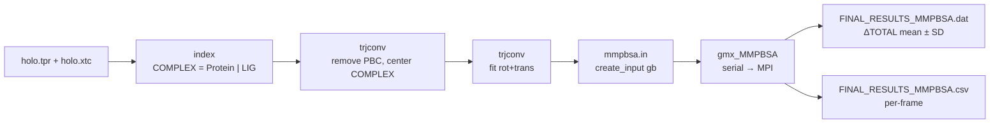

# MM/GBSA binding free energy (gmx_MMPBSA)

MM/GBSA is mostly used to **compare / rank** several ligands (or several poses) run with **the same protocol**.



## 1. Installation

See [docs/INSTALL.md → gmx_MMPBSA](../docs/INSTALL.md#5-gmx_mmpbsa-mmgbsa).

## 2. Prepare the GROMACS data

gmx_MMPBSA requires:
- a structure (`-cs`) that is whole / centred;
- a trajectory (`-ct`) with **PBC removed** and **fitted**.

```bash
# 2.1 (recommended) write a PDB to inspect the structure yourself
gmx editconf -f holo.tpr -o holo.pdb

# 2.2 create the COMPLEX group (Protein | Ligand)
gmx make_ndx -f holo.tpr -o index.ndx
```

```text
> r <LIG_RESNAME>              # e.g. r 5315649
> <id_Protein> | <id_LIG>
> name <new_id> COMPLEX
> q
```

```bash
# 2.3 remove PBC (centre on COMPLEX)            center: COMPLEX   output: System
gmx trjconv -s holo.tpr -f holo.xtc -o holo_noPBC.xtc -pbc mol -center -ur compact -n index.ndx
#   if PBC artefacts remain, run -pbc nojump first

# 2.4 fit rot+trans on COMPLEX                  fit: COMPLEX      output: System
gmx trjconv -s holo.tpr -f holo_noPBC.xtc -o holo_fit.xtc -fit rot+trans -n index.ndx
```

## 3. Find the group numbers for `-cg`

```bash
gmx make_ndx -n index.ndx      # prints the groups with their numbers; note Protein and LIG, then type q
```

`-cg <Receptor group> <Ligand group>` — for example `-cg 1 13`.

## 4. Create the MM/GBSA input

```bash
gmx_MMPBSA --create_input gb       # writes a template mmpbsa.in
```

For long (e.g. 500 ns) trajectories, set `startframe`, `endframe` and `interval` in `mmpbsa.in` to use ~200–500 evenly spaced frames from the equilibrated part.

## 5. Run (serial first, for easier debugging; ~3 h depending on the complex)

```bash
gmx_MMPBSA -O -i mmpbsa.in -cs holo.tpr -ct holo_fit.xtc -ci index.ndx -cg 1 13 \
    -lm LIG.mol2 -o FINAL_RESULTS_MMPBSA.dat -eo FINAL_RESULTS_MMPBSA.csv
```

## 6. Serial run OK → use MPI for speed

```bash
mpirun -np 8 gmx_MMPBSA -O -i mmpbsa.in -cs md_0_10.tpr -ct holo_fit.xtc -ci index.ndx \
    -cg PROT_NO LIG_NO -cp topol.top -o FINAL_RESULTS_MMPBSA.dat -eo FINAL_RESULTS_MMPBSA.csv
```

## 7. Read the results

| File | Content |
|------|---------|
| `FINAL_RESULTS_MMPBSA.dat` | **DELTA** section → line **ΔTOTAL** = estimated ΔG_bind (kcal/mol) with SD/SEM |
| `FINAL_RESULTS_MMPBSA.csv` | per-frame values → boxplots / time trends |

ΔG_bind = G(complex) − G(receptor) − G(ligand). How to interpret each term (ΔVDWAALS, ΔEEL, ΔEGB, ΔESURF): see [docs/MD_results_interpretation.md](../docs/MD_results_interpretation.md#g-mmgbsa).

Common error (`ChamberParm does not support all potential terms…`): see [docs/TROUBLESHOOTING.md](../docs/TROUBLESHOOTING.md#3-gmx_mmpbsa-chamberparm-error).

## References

- Valdés-Tresanco M. S. et al. *gmx_MMPBSA: A New Tool to Perform End-State Free Energy Calculations with GROMACS.* **J. Chem. Theory Comput.** 17, 6281–6291 (2021).
