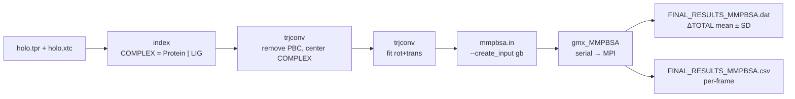

# MM/GBSA binding free energy (gmx_MMPBSA)

MM/GBSA thường dùng để **so sánh / xếp hạng** nhiều ligand (hoặc nhiều pose) trong **cùng một protocol**.



## 1. Cài đặt

Xem [docs/INSTALL.md → gmx_MMPBSA](../docs/INSTALL.md#5-gmx_mmpbsa-mmgbsa).

## 2. Chuẩn bị dữ liệu GROMACS

gmx_MMPBSA yêu cầu:
- structure (`-cs`) phải "nguyên vẹn / centered";
- trajectory (`-ct`) phải đã **remove PBC** và **fitted**.

```bash
# 2.1 (khuyến nghị) xuất PDB để tự kiểm tra structure
gmx editconf -f holo.tpr -o holo.pdb

# 2.2 tạo group COMPLEX (Protein | Ligand)
gmx make_ndx -f holo.tpr -o index.ndx
```

```text
> r <LIG_RESNAME>              # ví dụ: r 5315649
> <id_Protein> | <id_LIG>
> name <id_moi> COMPLEX
> q
```

```bash
# 2.3 remove PBC (center theo COMPLEX)          center: COMPLEX   output: System
gmx trjconv -s holo.tpr -f holo.xtc -o holo_noPBC.xtc -pbc mol -center -ur compact -n index.ndx
#   nếu chưa sạch PBC, cân nhắc chạy -pbc nojump trước

# 2.4 fit rot+trans theo COMPLEX                fit: COMPLEX      output: System
gmx trjconv -s holo.tpr -f holo_noPBC.xtc -o holo_fit.xtc -fit rot+trans -n index.ndx
```

## 3. Xác định số nhóm cho `-cg`

```bash
gmx make_ndx -n index.ndx      # in danh sách group, ghi lại số của Protein và LIG, gõ q
```

`-cg <Receptor group> <Ligand group>` — ví dụ `-cg 1 13`.

## 4. Tạo input MM/GBSA

```bash
gmx_MMPBSA --create_input gb       # sinh template mmpbsa.in
```

## 5. Chạy (serial trước để debug, ~3 giờ tuỳ complex)

```bash
gmx_MMPBSA -O -i mmpbsa.in -cs holo.tpr -ct holo_fit.xtc -ci index.ndx -cg 1 13 \
    -lm LIG.mol2 -o FINAL_RESULTS_MMPBSA.dat -eo FINAL_RESULTS_MMPBSA.csv
```

## 6. Serial OK → chạy MPI cho nhanh

```bash
mpirun -np 8 gmx_MMPBSA -O -i mmpbsa.in -cs md_0_10.tpr -ct holo_fit.xtc -ci index.ndx \
    -cg PROT_NO LIG_NO -cp topol.top -o FINAL_RESULTS_MMPBSA.dat -eo FINAL_RESULTS_MMPBSA.csv
```

## 7. Đọc kết quả

| File | Nội dung |
|------|----------|
| `FINAL_RESULTS_MMPBSA.dat` | mục **DELTA** → dòng **ΔTOTAL** = ước lượng ΔG_bind (kcal/mol), kèm SD/SEM |
| `FINAL_RESULTS_MMPBSA.csv` | giá trị theo từng frame → vẽ boxplot / trend |

ΔG_bind = G(complex) − G(receptor) − G(ligand). Cách diễn giải từng thành phần (ΔVDWAALS, ΔEEL, ΔEGB, ΔESURF): xem [docs/MD_results_interpretation.md](../docs/MD_results_interpretation.md#g-mmgbsa).

Lỗi thường gặp (`ChamberParm does not support all potential terms…`): xem [docs/TROUBLESHOOTING.md](../docs/TROUBLESHOOTING.md).

## Tham khảo

- Valdés-Tresanco M. S. et al. *gmx_MMPBSA: A New Tool to Perform End-State Free Energy Calculations with GROMACS.* **J. Chem. Theory Comput.** 17, 6281–6291 (2021).
