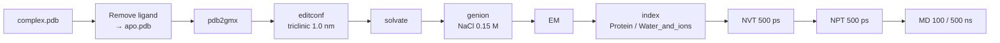

# APO MD — Protein only (GROMACS)

Simulation of the **protein without its ligand**, used as the control for HOLO. The workflow is the same as [HOLO](../holo/README.md) with every ligand step removed and simpler thermostat / index handling.



## Parameter files (`mdp/`)

Identical to the HOLO `.mdp` set except for the thermostat line:

```diff
- tc-grps = Protein_UNL Water_and_ions
+ tc-grps = Protein     Water_and_ions
```

| File | Stage |
|------|-------|
| [`ions.mdp`](mdp/ions.mdp) | adding ions |
| [`EM.mdp`](mdp/EM.mdp) | energy minimisation |
| [`NVT.mdp`](mdp/NVT.mdp) | NVT 500 ps, 298 K |
| [`NPT.mdp`](mdp/NPT.mdp) | NPT 500 ps, 1 bar |
| [`MD.mdp`](mdp/MD.mdp) / [`MD_500ns.mdp`](mdp/MD_500ns.mdp) | production 100 / 500 ns |

---

## 0. Setup

Install the environment: [docs/INSTALL.md](../../docs/INSTALL.md). Create a working directory:

```bash
mkdir apo_md && cd apo_md
```

> **Automated preparation with structure repair:** [`scripts/prepare_system.sh`](../../scripts/prepare_system.sh) models missing residues, rebuilds missing atoms, runs `pdb2gmx`, adds water + ions and writes the index file:
> ```bash
> bash scripts/prepare_system.sh --system apo --pdb input.pdb --workdir runs/my_run
> ```
> Using a different force field: [docs/FORCE_FIELDS.md](../../docs/FORCE_FIELDS.md).

## 1. Prepare the input (APO)

**Goal:** create `apo.pdb` (protein only) from `complex.pdb` (protein + ligand).

**Option A (easy): Chimera / PyMOL**
- Open the complex PDB.
- Delete the ligand residue(s) (usually `HETATM` lines with a residue name such as `UNL` / `JZ4` / …).
- Save as `apo.pdb`.

**Option B (command line, when the ligand has a clear residue name, e.g. `UNL`):**

```bash
grep -v " UNL " complex.pdb > apo.pdb
```

> Crystallographic waters and ions can be removed here as well (optional); GROMACS adds solvent and ions again later.

## 2. Topology (protein only)

```bash
gmx pdb2gmx -f apo.pdb -o processed.gro -p topol.top -ter
```

- Force field: **15** (OPLS-AA/L in the default list), water model: **6** — the same as HOLO.
- Termini: `NH3+` / `COO-` when asked.

✅ APO: **no** ligand topology, **no** `lig.itp`, **no** `complex.gro` merge.

## 3. Define the box

```bash
gmx editconf -f processed.gro -o newbox.gro -bt triclinic -d 1.0
```

## 4. Solvation

```bash
gmx solvate -cp newbox.gro -cs spc216.gro -p topol.top -o solv.gro
```

## 5. Add ions

```bash
gmx grompp -f ions.mdp -c solv.gro -p topol.top -o ions.tpr
gmx genion -s ions.tpr -o solv_ions.gro -p topol.top -pname NA -nname CL -neutral -conc 0.15
```

When `genion` asks which group to replace, choose **SOL**. `[ molecules ]` then looks like this (numbers will differ):

```text
[ molecules ]
; Compound        #mols
Protein_chain_A     1
SOL             10228
NA                 XX
CL                 YY
```

✅ Important: **no ligand line** (UNL / JZ4 / …).

## 6. Energy minimisation

```bash
gmx grompp -f EM.mdp -c solv_ions.gro -p topol.top -o em.tpr
gmx mdrun -v -deffnm em
```

## 7. Index + thermostat

```bash
gmx make_ndx -f em.gro -o index.ndx
# type q
```

In `NVT.mdp`, `NPT.mdp` and `MD.mdp`:

```text
tc-grps = Protein Water_and_ions
tau_t   = 0.1 0.1
ref_t   = 298 298
```

If `grompp` reports that the `Water_and_ions` group does not exist:

```text
> r SOL | r NA | r CL
> name XX Water_and_ions      # XX = number of the group just created
> q
```

## 8. NVT

```bash
source ~/gromacs-2023.3-cuda/bin/GMXRC   # if needed
gmx grompp -f NVT.mdp -c em.gro -r em.gro -p topol.top -n index.ndx -o nvt.tpr -maxwarn 5
gmx mdrun -deffnm nvt
```

## 9. NPT

```bash
gmx grompp -f NPT.mdp -c nvt.gro -t nvt.cpt -r nvt.gro -p topol.top -n index.ndx -o npt.tpr -maxwarn 5
gmx mdrun -deffnm npt
```

## 10. Production MD

```bash
gmx grompp -f MD.mdp -c npt.gro -t npt.cpt -p topol.top -n index.ndx -o md_0_10.tpr -maxwarn 5
gmx mdrun -deffnm md_0_10
```

> **500 ns option:** replace `MD.mdp` with [`MD_500ns.mdp`](mdp/MD_500ns.mdp) — every other step stays the same. Extending an existing 100 ns run, run time and disk space: [docs/EXTENDED_500NS.md](../../docs/EXTENDED_500NS.md).
>
> **Slow workstation?** Run EM → MD automatically on a rented GPU: [runpod/README.md](../../runpod/README.md) (`run_md.sh --system apo`).

---

## 11. APO analysis

### 11.0 Clean up the trajectory (PBC + centring)

```bash
gmx trjconv -s md_0_10.tpr -f md_0_10.xtc -o md_nopbc.xtc -pbc mol -center -ur compact
# Center: Protein   Output: System

# (optional) fit on the protein, reused by several analyses
gmx trjconv -s md_0_10.tpr -f md_nopbc.xtc -o md_fit.xtc -fit rot+trans
# Fit group: Backbone (or C-alpha)   Output: System
```

### 11.1 – 11.5 Metrics

| Metric | Command | Groups |
|--------|---------|--------|
| RMSD | `gmx rms -s md_0_10.tpr -f md_fit.xtc -o rmsd_apo.xvg -tu ns` | Fit: Backbone · RMSD: Backbone (or C-alpha) |
| Per-residue RMSF | `gmx rmsf -s md_0_10.tpr -f md_fit.xtc -o rmsf_res_apo.xvg -res` | C-alpha |
| SASA (over time + per residue) | `gmx sasa -s md_0_10.tpr -f md_fit.xtc -o sasa_apo_t.xvg -or sasa_apo_res.xvg -tu ns -surface "Protein" -output "Protein"` | — |
| Rg | `gmx gyrate -s md_0_10.tpr -f md_fit.xtc -o rg_apo.xvg -tu ns` | Protein |
| Intra-protein H-bonds (legacy) | `gmx hbond-legacy -s md_0_10.tpr -f md_fit.xtc -num hb_apo.xvg -tu ns` | Protein · Protein |
| H-bonds (GROMACS 2024+) | `gmx hbond -f md_fit.xtc -s md_0_10.tpr -r "Protein" -t "Protein" -num hb_apo.xvg -tu ns` | selections |

Quick look: `xmgrace rmsd_apo.xvg`. Figures: notebook [`../notebooks/apo_quick_plots.ipynb`](../notebooks/apo_quick_plots.ipynb).

> For a direct comparison with HOLO, use the unified pipeline in [ANALYSIS.md](../ANALYSIS.md).

---

## APO vs HOLO checklist

- [ ] Ligand removed from the PDB → `apo.pdb`
- [ ] `pdb2gmx` run on the APO structure → new `topol.top`
- [ ] `[ molecules ]` has **no** ligand
- [ ] `tc-grps` uses **Protein + Water_and_ions** (no ligand group)
- [ ] NVT → NPT → MD run without group errors
