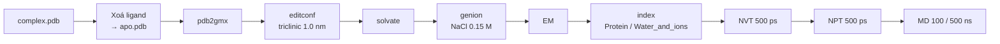

# APO MD — Protein-only (GROMACS)

Mô phỏng **protein không có ligand** làm đối chứng cho HOLO. Quy trình giống [HOLO](../holo/README.md) nhưng bỏ toàn bộ bước liên quan tới ligand và đơn giản hoá phần thermostat/index.



## File tham số (`mdp/`)

Giống hệt bộ `.mdp` của HOLO, chỉ khác dòng thermostat:

```diff
- tc-grps = Protein_UNL Water_and_ions
+ tc-grps = Protein     Water_and_ions
```

| File | Giai đoạn |
|------|-----------|
| [`ions.mdp`](mdp/ions.mdp) | thêm ion |
| [`EM.mdp`](mdp/EM.mdp) | energy minimization |
| [`NVT.mdp`](mdp/NVT.mdp) | NVT 500 ps, 298 K |
| [`NPT.mdp`](mdp/NPT.mdp) | NPT 500 ps, 1 bar |
| [`MD.mdp`](mdp/MD.mdp) / [`MD_500ns.mdp`](mdp/MD_500ns.mdp) | production 100 / 500 ns |

---

## 0. Chuẩn bị

Cài đặt môi trường: [docs/INSTALL.md](../../docs/INSTALL.md). Tạo thư mục làm việc:

```bash
mkdir apo_md && cd apo_md
```


> **Tự động hoá bước chuẩn bị + sửa lỗi cấu trúc:** [`scripts/prepare_system.sh`](../../scripts/prepare_system.sh) tự model missing residues, dựng lại atom thiếu, chạy `pdb2gmx`, thêm nước + ion và tạo index:
> ```bash
> bash scripts/prepare_system.sh --system apo --pdb input.pdb --workdir runs/my_run
> ```
> Chọn force field khác: [docs/FORCE_FIELDS.md](../../docs/FORCE_FIELDS.md).

## 1. Chuẩn bị dữ liệu (APO)

**Mục tiêu:** tạo `apo.pdb` (chỉ có protein) từ `complex.pdb` (protein + ligand).

**Cách A (dễ): Chimera/PyMOL**
- Mở file complex PDB.
- Xoá residue ligand (thường là dòng `HETATM`, resname như `UNL`/`JZ4`/…).
- Lưu thành `apo.pdb`.

**Cách B (CLI, nếu ligand có resname rõ ràng, ví dụ `UNL`):**

```bash
grep -v " UNL " complex.pdb > apo.pdb
```

> Có thể xoá luôn nước tinh thể / ion ở bước này (tuỳ chọn); dung môi và ion sẽ được GROMACS thêm lại.

## 2. Topology (protein-only)

```bash
gmx pdb2gmx -f apo.pdb -o processed.gro -p topol.top -ter
```

- Force field: **15** (OPLS-AA/L trong danh sách mặc định), water model: **6** — giống HOLO.
- Termini: `NH3+` / `COO-` nếu được hỏi.

✅ APO: **không** có topology ligand, **không** `lig.itp`, **không** bước ghép `complex.gro`.

## 3. Định nghĩa hộp

```bash
gmx editconf -f processed.gro -o newbox.gro -bt triclinic -d 1.0
```

## 4. Solvation

```bash
gmx solvate -cp newbox.gro -cs spc216.gro -p topol.top -o solv.gro
```

## 5. Thêm ion

```bash
gmx grompp -f ions.mdp -c solv.gro -p topol.top -o ions.tpr
gmx genion -s ions.tpr -o solv_ions.gro -p topol.top -pname NA -nname CL -neutral -conc 0.15
```

Khi `genion` hỏi nhóm để thay, chọn **SOL**. `[ molecules ]` sau đó (số lượng sẽ khác):

```text
[ molecules ]
; Compound        #mols
Protein_chain_A     1
SOL             10228
NA                 XX
CL                 YY
```

✅ Quan trọng: **không có dòng ligand** (UNL/JZ4/…).

## 6. Energy minimization

```bash
gmx grompp -f EM.mdp -c solv_ions.gro -p topol.top -o em.tpr
gmx mdrun -v -deffnm em
```

## 7. Index + thermostat

```bash
gmx make_ndx -f em.gro -o index.ndx
# gõ q
```

Trong `NVT.mdp`, `NPT.mdp`, `MD.mdp`:

```text
tc-grps = Protein Water_and_ions
tau_t   = 0.1 0.1
ref_t   = 298 298
```

Nếu báo lỗi không có nhóm `Water_and_ions`:

```text
> r SOL | r NA | r CL
> name XX Water_and_ions      # XX = số nhóm vừa tạo
> q
```

## 8. NVT

```bash
source ~/gromacs-2023.3-cuda/bin/GMXRC   # nếu cần
gmx grompp -f NVT.mdp -c em.gro -r em.gro -p topol.top -n index.ndx -o nvt.tpr -maxwarn 5
gmx mdrun -deffnm nvt
```

## 9. NPT

```bash
gmx grompp -f NPT.mdp -c nvt.gro -t nvt.cpt -r nvt.gro -p topol.top -n index.ndx -o npt.tpr -maxwarn 5
gmx mdrun -deffnm npt
```

## 10. Production MD

```bash
gmx grompp -f MD.mdp -c npt.gro -t npt.cpt -p topol.top -n index.ndx -o md_0_10.tpr -maxwarn 5
gmx mdrun -deffnm md_0_10
```

> **Tuỳ chọn 500 ns:** thay `MD.mdp` bằng [`MD_500ns.mdp`](mdp/MD_500ns.mdp) — mọi bước khác giữ nguyên. Kéo dài run 100 ns có sẵn, thời gian & dung lượng: [docs/EXTENDED_500NS.md](../../docs/EXTENDED_500NS.md).
>
> **Máy chậm?** Chạy EM → MD tự động trên GPU thuê: [runpod/README.md](../../runpod/README.md) (`run_md.sh --system apo`).

---

## 11. Phân tích APO

### 11.0 Chuẩn hoá trajectory (PBC + center)

```bash
gmx trjconv -s md_0_10.tpr -f md_0_10.xtc -o md_nopbc.xtc -pbc mol -center -ur compact
# Center: Protein   Output: System

# (tuỳ chọn) fit theo protein để dùng chung cho nhiều phân tích
gmx trjconv -s md_0_10.tpr -f md_nopbc.xtc -o md_fit.xtc -fit rot+trans
# Fit group: Backbone (hoặc C-alpha)   Output: System
```

### 11.1 – 11.5 Các chỉ số

| Chỉ số | Lệnh | Chọn nhóm |
|--------|------|-----------|
| RMSD | `gmx rms -s md_0_10.tpr -f md_fit.xtc -o rmsd_apo.xvg -tu ns` | Fit: Backbone · RMSD: Backbone (hoặc C-alpha) |
| RMSF theo residue | `gmx rmsf -s md_0_10.tpr -f md_fit.xtc -o rmsf_res_apo.xvg -res` | C-alpha |
| SASA (theo thời gian + residue) | `gmx sasa -s md_0_10.tpr -f md_fit.xtc -o sasa_apo_t.xvg -or sasa_apo_res.xvg -tu ns -surface "Protein" -output "Protein"` | — |
| Rg | `gmx gyrate -s md_0_10.tpr -f md_fit.xtc -o rg_apo.xvg -tu ns` | Protein |
| H-bond nội protein (kiểu cũ) | `gmx hbond-legacy -s md_0_10.tpr -f md_fit.xtc -num hb_apo.xvg -tu ns` | Protein · Protein |
| H-bond (GROMACS 2024+) | `gmx hbond -f md_fit.xtc -s md_0_10.tpr -r "Protein" -t "Protein" -num hb_apo.xvg -tu ns` | selection |

Xem nhanh: `xmgrace rmsd_apo.xvg`. Vẽ hình: notebook [`../notebooks/apo_quick_plots.ipynb`](../notebooks/apo_quick_plots.ipynb).

> Để so sánh trực tiếp với HOLO, dùng pipeline thống nhất trong [ANALYSIS.md](../ANALYSIS.md).

---

## Checklist APO vs HOLO

- [ ] Đã xoá ligand khỏi PDB → `apo.pdb`
- [ ] Chạy `pdb2gmx` trên apo → `topol.top` mới
- [ ] `[ molecules ]` **không** có ligand
- [ ] `tc-grps` dùng **Protein + Water_and_ions** (không có nhóm ligand)
- [ ] NVT → NPT → MD chạy không lỗi nhóm
