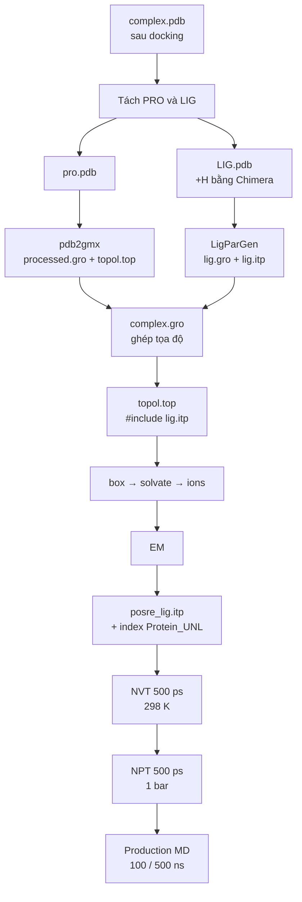

# HOLO MD — Protein + Ligand (GROMACS)

Mô phỏng phức hợp **protein–ligand** sau docking. Ligand được tham số hoá bằng **LigParGen (OPLS-AA)**, protein dùng force field **OPLS-AA/L**.

> Quy trình chuẩn bị complex/topology dựa trên *Protein-Ligand Complex tutorial* của Justin A. Lemkul — xem [Tham khảo](#tham-khảo).
> Video hướng dẫn (thêm hydrogen bằng Chimera, LigParGen, toàn bộ quy trình) được lưu ngoài repo vì dung lượng lớn — xem [README chính](../../README.md#-tutorial-videos).



## File tham số (`mdp/`)

| File | Giai đoạn | Thiết lập chính |
|------|-----------|-----------------|
| [`ions.mdp`](mdp/ions.mdp) | chuẩn bị `.tpr` để thêm ion | steep, cutoff 1.0 nm |
| [`EM.mdp`](mdp/EM.mdp) | Energy minimization | steep, `emtol = 1000`, tối đa 5 000 bước, PME 1.2 nm |
| [`NVT.mdp`](mdp/NVT.mdp) | NVT equilibration | 500 ps, V-rescale 298 K, `-DPOSRES` |
| [`NPT.mdp`](mdp/NPT.mdp) | NPT equilibration | 500 ps, Berendsen 1 bar, `-DPOSRES`, `refcoord_scaling = com` |
| [`MD.mdp`](mdp/MD.mdp) | Production MD | 100 ns, dt 2 fs, Parrinello-Rahman, lưu `.xtc` mỗi 20 ps |
| [`MD_500ns.mdp`](mdp/MD_500ns.mdp) | Production MD (dài) | 500 ns, cùng thiết lập với `MD.mdp` |

Chung: `tc-grps = Protein_UNL Water_and_ions`, LINCS (h-bonds), PME, `rvdw = rcoulomb = 1.2 nm`, `vdw-modifier = force-switch` (`rvdw-switch = 1.0`).

> `UNL` là resname của ligand trong file docking. Nếu ligand của bạn có tên khác (ví dụ `JZ4`), đổi `Protein_UNL` trong các file `.mdp` cho khớp với nhóm trong `index.ndx`.

---

## 0. Chuẩn bị

- Cài đặt GROMACS (CUDA), Chimera, conda env `gmx-ff`: xem [docs/INSTALL.md](../../docs/INSTALL.md).
- Tạo working space (thư mục mới để chạy MD), copy các file `mdp/` vào và chuyển vào thư mục đó:

```bash
cd /mnt/<đường-dẫn-working-space>
```

## 1. Chuẩn bị dữ liệu

Chuẩn bị file `complex.pdb`, sau đó tách protein và ligand:

```bash
# tách ligand
grep UNL 2NZ2_5482.pdb > LIG.pdb
```

- Tách protein: thủ công bằng Notepad (xoá dòng ligand) → `pro.pdb`.
- **Thêm hydrogen cho ligand bằng Chimera** và lưu lại `LIG.pdb`.

## 2. Topology cho protein

```bash
gmx pdb2gmx -f pro.pdb -o processed.gro -p topol.top -ter
```

- Force field: **OPLS-AA/L** (cùng họ OPLS-AA với tham số LigParGen của ligand).
- Water model: chọn mô hình nước 3-site (dung môi được thêm bằng `spc216.gro`).
- Termini: chọn `NH3+` và `COO-`. Bước chọn tương tác này cần thiết khi residue đầu N là methionine (MET), vì `pdb2gmx` có thể tự chọn kiểu terminus không tương thích.

> Hướng dẫn gốc của Lemkul dùng CHARMM36; nếu chọn CHARMM36 thì topology ligand phải sinh bằng CGenFF thay vì LigParGen.

## 3. Topology cho ligand

Dùng web **LigParGen**: https://zarbi.chem.yale.edu/ligpargen/ → tải `lig.gro` (hoặc `.pdb`) và `lig.itp`.

## 4. Ghép complex

1. Copy `processed.gro` thành `complex.gro`.
2. Copy phần tọa độ của `lig.gro` và dán vào `complex.gro`, **ngay dưới dòng atom cuối cùng của protein và trước dòng box vectors**.
3. Vì đã thêm `XXXX` atom, tăng số atom ở **dòng thứ 2** của `complex.gro`: từ `AAAA` thành `AAAA + XXXX`.

## 5. Ghép topology

Ở **đầu** `topol.top`, thêm `#include` cho ligand ngay sau phần force field:

```text
; Include forcefield parameters
#include "oplsaa.ff/forcefield.itp"

; Include ligand topology
#include "lig.itp"

[ moleculetype ]
; Name            nrexcl
Protein_chain_A     3
```

Cuối file, thêm ligand vào `[ molecules ]`:

```text
[ molecules ]
; Compound        #mols
Protein_chain_A     1
UNL                 1
```

Topology và file tọa độ giờ đã khớp nhau về thành phần hệ.

## 6. Định nghĩa hộp

```bash
gmx editconf -f complex.gro -o newbox.gro -bt triclinic -d 1.0
```

## 7. Solvation

```bash
gmx solvate -cp newbox.gro -cs spc216.gro -p topol.top -o solv.gro
```

## 8. Thêm ion

```bash
gmx grompp -f ions.mdp -c solv.gro -p topol.top -o ions.tpr
gmx genion -s ions.tpr -o solv_ions.gro -p topol.top -pname NA -nname CL -neutral -conc 0.15
# chọn nhóm SOL (ví dụ 15)
```

`[ molecules ]` lúc này có dạng (số lượng sẽ khác):

```text
[ molecules ]
; Compound        #mols
Protein_chain_A     1
UNL                 1
SOL             10228
CL                  6
```

## 9. Energy minimization

```bash
gmx grompp -f EM.mdp -c solv_ions.gro -p topol.top -o em.tpr
gmx mdrun -v -deffnm em
```

## 10. Position restraint cho ligand

```bash
gmx make_ndx -f lig.gro -o index_lig.ndx
```

```text
> 0 & ! a H*        # ligand không tính hydrogen
> q
```

```bash
gmx genrestr -f lig.gro -n index_lig.ndx -o posre_lig.itp -fc 1000 1000 1000
```

Thêm vào `topol.top`, ngay sau dòng `#include "lig.itp"`:

```text
; Ligand position restraints
#ifdef POSRES
#include "posre_lig.itp"
#endif
```

## 11. Nhóm ghép nhiệt (thermostat)

```bash
gmx make_ndx -f em.gro -o index.ndx
```

Gộp nhóm `Protein` và `UNL` (số nhóm tuỳ hệ):

```text
> 1 | 13
> q
```

Khi đó `tc-grps = Protein_UNL Water_and_ions` cho hiệu ứng "Protein / Non-Protein" mong muốn.

> Kiểm tra `solv_ions.gro` có ion CL hay không. Nếu không, sửa lại `.mdp`; nếu có mà `grompp` vẫn báo fatal error, tạo lại nhóm `Water_and_ions` bằng `make_ndx` (xem [Troubleshooting](../../docs/TROUBLESHOOTING.md)).

## 12. Nạp GPU (CUDA) trước khi chạy

```bash
source $HOME/gromacs-2023.3-cuda/bin/GMXRC
gmx --version      # cần thấy: GPU support: CUDA
```

## 13. Equilibration — pha 1 (NVT)

```bash
gmx grompp -f NVT.mdp -c em.gro -r em.gro -p topol.top -n index.ndx -o nvt.tpr
gmx mdrun -deffnm nvt
```

## 14. Equilibration — pha 2 (NPT)

```bash
gmx grompp -f NPT.mdp -c nvt.gro -t nvt.cpt -r nvt.gro -p topol.top -n index.ndx -o npt.tpr
gmx mdrun -deffnm npt
```

## 15. Production MD

```bash
gmx grompp -f MD.mdp -c npt.gro -t npt.cpt -p topol.top -n index.ndx -o md_0_10.tpr
gmx mdrun -deffnm md_0_10
```

> **Tuỳ chọn 500 ns:** thay `MD.mdp` bằng [`MD_500ns.mdp`](mdp/MD_500ns.mdp) — mọi bước khác giữ nguyên. Kéo dài run 100 ns có sẵn, thời gian & dung lượng: [docs/EXTENDED_500NS.md](../../docs/EXTENDED_500NS.md).
>
> **Máy chậm?** Chạy EM → MD tự động trên GPU thuê: [runpod/README.md](../../runpod/README.md) (`run_md.sh --system holo`).

---

## Bước tiếp theo

- So sánh APO vs HOLO: [ANALYSIS.md](../ANALYSIS.md)
- Năng lượng liên kết: [MMGBSA.md](../MMGBSA.md)
- Cách đọc kết quả: [docs/MD_results_interpretation.md](../../docs/MD_results_interpretation.md)

## Tham khảo

- Lemkul J. A. *GROMACS Tutorials — Protein-Ligand Complex.* http://www.mdtutorials.com/gmx/complex/
- Dodda L. S. et al. *LigParGen web server: an automatic OPLS-AA parameter generator for organic ligands.* **Nucleic Acids Res.** 45, W331–W336 (2017).
