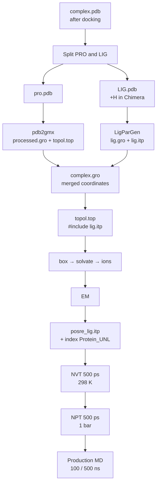

# HOLO MD — Protein + Ligand (GROMACS)

Simulation of a **protein–ligand complex** after docking. The ligand is parameterised with **LigParGen (OPLS-AA)** and the protein uses the **OPLS-AA/L** force field.

> Complex and topology preparation follow the *Protein-Ligand Complex* tutorial by Justin A. Lemkul — see [References](#references).
> The video tutorials (adding hydrogens in Chimera, LigParGen, the full workflow) are stored outside the repository because of their size — see the [main README](../../README.md#-tutorial-videos).



## Parameter files (`mdp/`)

| File | Stage | Key settings |
|------|-------|--------------|
| [`ions.mdp`](mdp/ions.mdp) | `.tpr` for adding ions | steepest descent, cut-off 1.0 nm |
| [`EM.mdp`](mdp/EM.mdp) | Energy minimisation | steepest descent, `emtol = 1000`, up to 5 000 steps, PME 1.2 nm |
| [`NVT.mdp`](mdp/NVT.mdp) | NVT equilibration | 500 ps, V-rescale 298 K, `-DPOSRES` |
| [`NPT.mdp`](mdp/NPT.mdp) | NPT equilibration | 500 ps, Berendsen 1 bar, `-DPOSRES`, `refcoord_scaling = com` |
| [`MD.mdp`](mdp/MD.mdp) | Production MD | 100 ns, dt 2 fs, Parrinello-Rahman, `.xtc` frame every 20 ps |
| [`MD_500ns.mdp`](mdp/MD_500ns.mdp) | Production MD (extended) | 500 ns, same physics as `MD.mdp`, frame every 100 ps |

Shared: `tc-grps = Protein_UNL Water_and_ions`, LINCS (h-bonds), PME, `rvdw = rcoulomb = 1.2 nm`, `vdw-modifier = force-switch` (`rvdw-switch = 1.0`).

> `UNL` is the residue name of the ligand in the docking output. If your ligand has another name (e.g. `JZ4`), make sure the merged group in `index.ndx` is named `Protein_UNL`, or rename `Protein_UNL` in the `.mdp` files.

---

## 0. Setup

- Install GROMACS (CUDA), Chimera and the `gmx-ff` conda environment: see [docs/INSTALL.md](../../docs/INSTALL.md).
- Create a working directory for the run, copy the `mdp/` files into it and move into it:

```bash
cd /mnt/<path-to-working-directory>
```

> **Automated preparation with structure repair:** [`scripts/prepare_system.sh`](../../scripts/prepare_system.sh) models missing residues, rebuilds missing atoms, runs `pdb2gmx`, merges the LigParGen ligand into `complex.gro` / `topol.top` (steps 4–5 and 10–11), adds water + ions and writes the index file:
> ```bash
> bash scripts/prepare_system.sh --system holo --pdb input.pdb --workdir runs/my_run --lig-gro lig.gro --lig-itp lig.itp
> ```
> Using a different force field: [docs/FORCE_FIELDS.md](../../docs/FORCE_FIELDS.md).

## 1. Prepare the input

Start from `complex.pdb` and split it into protein and ligand:

```bash
# extract the ligand
grep UNL 2NZ2_5482.pdb > LIG.pdb
```

- Extract the protein: delete the ligand lines in a text editor → `pro.pdb`.
- **Add hydrogens to the ligand in Chimera** and save it again as `LIG.pdb`.

## 2. Protein topology

```bash
gmx pdb2gmx -f pro.pdb -o processed.gro -p topol.top -ter
```

- Force field: **OPLS-AA/L** (same OPLS-AA family as the LigParGen ligand parameters).
- Water model: a 3-site model (the solvent box is `spc216.gro`).
- Termini: choose `NH3+` and `COO-`. The interactive choice is needed when the N-terminal residue is methionine (MET), because `pdb2gmx` may otherwise pick an incompatible terminus type.

> Lemkul's original tutorial uses CHARMM36; with CHARMM36 the ligand topology must come from CGenFF instead of LigParGen.

## 3. Ligand topology

Use the **LigParGen** web server: https://zarbi.chem.yale.edu/ligpargen/ → download `lig.gro` (or `.pdb`) and `lig.itp`.

## 4. Build the complex

1. Copy `processed.gro` to `complex.gro`.
2. Copy the coordinate lines of `lig.gro` into `complex.gro`, **right after the last protein atom and before the box-vector line**.
3. Because `XXXX` atoms were added, increase the atom count on **line 2** of `complex.gro` from `AAAA` to `AAAA + XXXX`.

## 5. Build the topology

At the **top** of `topol.top`, add an `#include` for the ligand right after the force-field include:

```text
; Include forcefield parameters
#include "oplsaa.ff/forcefield.itp"

; Include ligand topology
#include "lig.itp"

[ moleculetype ]
; Name            nrexcl
Protein_chain_A     3
```

At the end of the file, add the ligand to `[ molecules ]`:

```text
[ molecules ]
; Compound        #mols
Protein_chain_A     1
UNL                 1
```

The topology and the coordinate file now describe the same system.

## 6. Define the box

```bash
gmx editconf -f complex.gro -o newbox.gro -bt triclinic -d 1.0
```

## 7. Solvation

```bash
gmx solvate -cp newbox.gro -cs spc216.gro -p topol.top -o solv.gro
```

## 8. Add ions

```bash
gmx grompp -f ions.mdp -c solv.gro -p topol.top -o ions.tpr
gmx genion -s ions.tpr -o solv_ions.gro -p topol.top -pname NA -nname CL -neutral -conc 0.15
# select the SOL group (e.g. 15)
```

`[ molecules ]` now looks like this (numbers will differ):

```text
[ molecules ]
; Compound        #mols
Protein_chain_A     1
UNL                 1
SOL             10228
CL                  6
```

## 9. Energy minimisation

```bash
gmx grompp -f EM.mdp -c solv_ions.gro -p topol.top -o em.tpr
gmx mdrun -v -deffnm em
```

## 10. Ligand position restraints

```bash
gmx make_ndx -f lig.gro -o index_lig.ndx
```

```text
> 0 & ! a H*        # ligand heavy atoms only
> q
```

```bash
gmx genrestr -f lig.gro -n index_lig.ndx -o posre_lig.itp -fc 1000 1000 1000
```

Add to `topol.top`, right after the `#include "lig.itp"` line:

```text
; Ligand position restraints
#ifdef POSRES
#include "posre_lig.itp"
#endif
```

## 11. Thermostat coupling groups

```bash
gmx make_ndx -f em.gro -o index.ndx
```

Merge the `Protein` and `UNL` groups (group numbers depend on the system):

```text
> 1 | 13
> q
```

With this, `tc-grps = Protein_UNL Water_and_ions` gives the intended "protein / non-protein" coupling.

> Check whether `solv_ions.gro` contains CL ions. If not, adjust the `.mdp`; if it does and `grompp` still reports a fatal error, recreate the `Water_and_ions` group with `make_ndx` (see [Troubleshooting](../../docs/TROUBLESHOOTING.md)).

## 12. Load the GPU (CUDA) build before running

```bash
source $HOME/gromacs-2023.3-cuda/bin/GMXRC
gmx --version      # expect: GPU support: CUDA
```

## 13. Equilibration — phase 1 (NVT)

```bash
gmx grompp -f NVT.mdp -c em.gro -r em.gro -p topol.top -n index.ndx -o nvt.tpr
gmx mdrun -deffnm nvt
```

## 14. Equilibration — phase 2 (NPT)

```bash
gmx grompp -f NPT.mdp -c nvt.gro -t nvt.cpt -r nvt.gro -p topol.top -n index.ndx -o npt.tpr
gmx mdrun -deffnm npt
```

## 15. Production MD

```bash
gmx grompp -f MD.mdp -c npt.gro -t npt.cpt -p topol.top -n index.ndx -o md_0_10.tpr
gmx mdrun -deffnm md_0_10
```

> **500 ns option:** replace `MD.mdp` with [`MD_500ns.mdp`](mdp/MD_500ns.mdp) — every other step stays the same. Extending an existing 100 ns run, run time and disk space: [docs/EXTENDED_500NS.md](../../docs/EXTENDED_500NS.md).
>
> **Slow workstation?** Run EM → MD automatically on a rented GPU: [runpod/README.md](../../runpod/README.md) (`run_md.sh --system holo`).

---

## Next steps

- Compare APO vs HOLO: [ANALYSIS.md](../ANALYSIS.md)
- Binding free energy: [MMGBSA.md](../MMGBSA.md)
- Reading the results: [docs/MD_results_interpretation.md](../../docs/MD_results_interpretation.md)

## References

- Lemkul J. A. *GROMACS Tutorials — Protein-Ligand Complex.* http://www.mdtutorials.com/gmx/complex/
- Dodda L. S. et al. *LigParGen web server: an automatic OPLS-AA parameter generator for organic ligands.* **Nucleic Acids Res.** 45, W331–W336 (2017).
