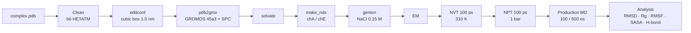

# Protein–Protein MD (GROMACS)

Quy trình mô phỏng động lực học phân tử cho **phức hợp protein–protein**, từ file PDB đến phân tích tương tác tại bề mặt tiếp xúc (interface).

> **Ví dụ trong hướng dẫn:** PD-1 / PD-L1 (PDB **3BIK**). Thay `3bik` bằng tên complex của bạn.
> Quy trình được phát triển dựa trên GROMACS protocol của Yang & Tseng (2023) — xem [Tham khảo](#tham-khảo).



## File tham số (`mdp/`)

| File | Giai đoạn | Thiết lập chính |
|------|-----------|-----------------|
| [`ions.mdp`](mdp/ions.mdp) | chuẩn bị `.tpr` để thêm ion | steep, cutoff 1.0 nm |
| [`minim.mdp`](mdp/minim.mdp) | Energy minimization | steep, `emtol = 1000` kJ/mol/nm, tối đa 50 000 bước, PME |
| [`nvt.mdp`](mdp/nvt.mdp) | NVT equilibration | 100 ps, V-rescale 310 K, `-DPOSRES`, sinh vận tốc 310 K |
| [`npt.mdp`](mdp/npt.mdp) | NPT equilibration | 100 ps, Parrinello-Rahman 1 bar, `-DPOSRES` |
| [`md.mdp`](mdp/md.mdp) | Production MD | 100 ns, dt 2 fs, lưu `.xtc` mỗi 10 ps |
| [`md_500ns.mdp`](mdp/md_500ns.mdp) | Production MD (dài) | 500 ns, cùng thiết lập với `md.mdp` |

Chung cho NVT/NPT/MD: `tc-grps = Protein Non-Protein`, LINCS (h-bonds), PME, `rcoulomb = rvdw = 1.0 nm`, `DispCorr = EnerPres`.

---

## 0. Chuẩn bị

1. Tạo **working space** và để hết các tập tin liên quan (`.pdb`, các file `.mdp`) vào đó.
2. Tải complex protein–protein định dạng `.pdb` (hoặc chuyển sang `.pdb` bằng **Chimera**).
3. Cài Ubuntu (WSL) + GROMACS — xem [docs/INSTALL.md](../docs/INSTALL.md).
4. Chuyển vào working space:

```bash
cd /mnt/<đường-dẫn-working-space>
source ~/gromacs-2023.3-cuda/bin/GMXRC     # nếu dùng bản build CUDA
```

> **Tự động hoá bước chuẩn bị + sửa lỗi cấu trúc:** [`scripts/prepare_system.sh`](../scripts/prepare_system.sh) tự model missing residues, dựng lại atom thiếu, chạy `pdb2gmx`, thêm nước + ion và tạo index:
> ```bash
> bash scripts/prepare_system.sh --system pp --pdb input.pdb --workdir runs/my_run
> ```
> Chọn force field khác: [docs/FORCE_FIELDS.md](../docs/FORCE_FIELDS.md).

---

## 1. Chuẩn bị complex

Chỉ giữ cấu trúc protein (loại `HETATM`, các ion và thành phần khác):

```bash
grep -v HETATM 3bik.pdb > 3bik_clean.pdb
```

Tạo hộp mô phỏng dạng **cubic**, căn giữa protein, khoảng cách 1.0 nm tới biên:

```bash
gmx editconf -f 3bik_clean.pdb -o 3bik_box.pdb -c -d 1.0 -bt cubic
```

> ⚠️ Ion Zn không được phép giữ lại trong file PDB khi mô phỏng.

## 2. Topology

```bash
gmx pdb2gmx -f 3bik_box.pdb -o 3bik_g.pdb -p LM.top -ff select -ignh -inter
```

- Force field: **GROMOS 45a3**, water model: **SPC**.
- Điện tích amino acid được chọn theo pH. Ví dụ pH 7.4:
  `LYSH: +1`, `ARG: +1`, `GLN: 0`, `ASP: −1`, `GLU: −1`, `HISA: ND1 only`, Cys linkage: *yes* cho tất cả, terminus: `NH3+`, `COO-`.

## 3. Solvation

```bash
gmx solvate -cp 3bik_g.pdb -o 3bik_sol.pdb -p LM.top -cs
```

## 4. Index cho từng chuỗi

Mở `3bik_sol.pdb` (Notepad) để xem residue của từng chain, sau đó:

```bash
gmx make_ndx -f 3bik_sol.pdb -o index.ndx
```

```text
> chainA        # → nhóm chA
> chainE        # → nhóm chE
> q             # lưu và thoát
```

Complex có bao nhiêu chain thì tạo bấy nhiêu nhóm.

## 5. Thêm ion (cần `ions.mdp`)

```bash
gmx grompp -c 3bik_sol.pdb -f ions.mdp -o ion.tpr -p LM.top -maxwarn 5
gmx genion -s ion.tpr -o 3bik_ion.pdb -p LM.top -pname NA -nname CL -neutral -conc 0.15
```

Chọn nhóm **SOL** (ví dụ `13`) để thay nước bằng ion.

<details>
<summary>Cách cũ: thêm số ion cố định và sửa <code>LM.top</code> thủ công</summary>

```bash
gmx genion -s ion.tpr -o 3bik_ion.pdb -pname NA -np 220 -nname CL -neutral
vi LM.top
```

Xuống cuối file (phím `G`) và cập nhật số phân tử:

```text
SOL 123     ->   SOL 120
            ->   NA  1
            ->   CL  2
```

Khi dùng `-p LM.top`, `genion` tự cập nhật topology nên không cần sửa tay.
</details>

## 6. Energy minimization (cần `minim.mdp`)

```bash
gmx grompp -c 3bik_ion.pdb -f minim.mdp -o em.tpr -p LM.top -n index.ndx -maxwarn 5
gmx mdrun -s em.tpr -o em.trr -c 3bik_em.pdb -g em.log -e em.edr
```

## 7. Equilibration

### 7.1 NVT (cần `nvt.mdp`)

```bash
gmx grompp -c 3bik_em.pdb -r 3bik_em.pdb -f nvt.mdp -o nvt.tpr -p LM.top -n index.ndx -maxwarn 5
gmx mdrun -deffnm nvt
```

### 7.2 NPT (cần `npt.mdp`)

```bash
gmx grompp -c nvt.gro -r nvt.gro -t nvt.cpt -f npt.mdp -o npt.tpr -p LM.top -n index.ndx -maxwarn 5
gmx mdrun -deffnm npt
```

## 8. Production MD (cần `md.mdp` hoặc `md_500ns.mdp`)

```bash
gmx grompp -c npt.gro -t npt.cpt -f md.mdp -o md.tpr -p LM.top -n index.ndx -maxwarn 5
gmx mdrun -s md.tpr -o md.trr -c 3bik_md.pdb -g md.log -e md.edr -cpo md.cpt
```

> **Tuỳ chọn 500 ns:** thay `md.mdp` bằng [`md_500ns.mdp`](mdp/md_500ns.mdp) — mọi bước khác giữ nguyên. Kéo dài run 100 ns có sẵn, thời gian & dung lượng: [docs/EXTENDED_500NS.md](../docs/EXTENDED_500NS.md).
>
> **Máy chậm?** Chạy EM → MD tự động trên GPU thuê: [runpod/README.md](../runpod/README.md) (`run_md.sh --system pp`).

### Chạy tiếp MD (cần `.edr`, `.log`, `.cpt`, `.tpr`, `traj_comp.xtc`)

```bash
gmx convert-tpr -s md_prev.tpr -o md.tpr -until 10000
gmx mdrun -s md.tpr -o md.trr -c 3bik_continue.pdb -g md.log -e md.edr -cpo md.cpt -cpi md_prev.cpt
```

---

## 9. Phân tích

### 9.1 Kiểm tra cân bằng

```bash
echo 10 0 | gmx energy -f em.edr  -o potential_em.xvg
echo 16 0 | gmx energy -f nvt.edr -o temperature_nvt.xvg   # chọn nhiệt độ tối ưu cho -temp
echo 18 0 | gmx energy -f npt.edr -o pressure_npt.xvg
echo 24 0 | gmx energy -f npt.edr -o density_npt.xvg
```

> Số thứ tự term (10, 16, 18, 24) phụ thuộc hệ — kiểm tra danh sách `gmx energy` in ra.

### 9.2 Index tách protein_1 và protein_2

Xem lại file complex để biết khoảng của từng protein:

```bash
gmx make_ndx -f 3bik_md.pdb -o index_md.ndx
```

Ví dụ 3BIK: nhóm 17 = `ri 1-2174` (PD-L1), nhóm 18 = `ri 2175-3565` (PD-1).

> `ri` chọn theo *residue index*, `a` chọn theo *atom number* — dùng đúng loại với khoảng số bạn đọc được trong file.

### 9.3 Hiệu chỉnh trajectory (PBC)

```bash
echo 1 1 | gmx trjconv -s md.tpr -f 3bik_md.pdb    -o 3bik_md_noPBC.pdb -pbc nojump -center
echo 1 0 | gmx trjconv -s md.tpr -f traj_comp.xtc  -o md_noPBC.xtc      -pbc nojump -center
```

### 9.4 Chỉ số cấu trúc

| Chỉ số | Lệnh | Output |
|--------|------|--------|
| RMSD (fit & tính trên backbone) | `echo 4 4 \| gmx rms -s md.tpr -f md_noPBC.xtc -o rmsd.xvg -tu ns` | `rmsd.xvg` |
| Radius of gyration | `echo 1 \| gmx gyrate -s md.tpr -f md_noPBC.xtc -o gyrate.xvg` | `gyrate.xvg` |
| RMSF — PD-L1 | `echo 17 \| gmx rmsf -s md.tpr -f md_noPBC.xtc -o rmsf_PDL1.xvg -res -n index_md.ndx` | `rmsf_PDL1.xvg` |
| RMSF — PD-1 | `echo 18 \| gmx rmsf -s md.tpr -f md_noPBC.xtc -o rmsf_PD1.xvg -res -n index_md.ndx` | `rmsf_PD1.xvg` |
| SASA | `echo 1 \| gmx sasa -s md.tpr -f md_noPBC.xtc -o sasa.xvg` | `sasa.xvg` |

### 9.5 Liên kết hydro tại interface

```bash
# số H-bond theo thời gian, autocorrelation, phân bố khoảng cách
echo 17 18 | gmx hbond -f md_noPBC.xtc -s md.tpr -n index_md.ndx -tu ns -temp 309.773 \
    -num hbnum.xvg -ac hbac.xvg -dist hbdist.xvg

# phân bố góc
echo 17 18 | gmx hbond -f md_noPBC.xtc -s md.tpr -n index_md.ndx -tu ns -temp 309.773 \
    -ang hbang.xvg -nomerge
```

> Từ GROMACS 2024, các tuỳ chọn kiểu cũ (`-ac`, `-dist`, `-ang`, `-temp`) nằm trong `gmx hbond-legacy`.

### 9.6 Vẽ hình

Mở VS Code và chạy các notebook/script vẽ hình với các file `.xvg` ở trên (xem [`scripts/`](../scripts)).

---

## Tham khảo

- Yang Y.-Y., Tseng Y. J. *The evolution of the spike protein and hACE2 interface of SARS-CoV-2 omicron variants determined by hydrogen bond formation.* **Briefings in Functional Genomics** (2023), elac053. https://doi.org/10.1093/bfgp/elac053
- GROMACS documentation: https://manual.gromacs.org/
