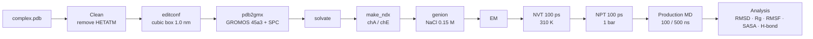

# Protein–Protein MD (GROMACS)

Molecular dynamics workflow for a **protein–protein complex**, from a PDB file to the analysis of interactions at the binding interface.

> **Example used in this guide:** PD-1 / PD-L1 (PDB **3BIK**). Replace `3bik` with the name of your complex.
> The workflow is developed from the GROMACS protocol of Yang & Tseng (2023) — see [References](#references).



## Parameter files (`mdp/`)

| File | Stage | Key settings |
|------|-------|--------------|
| [`ions.mdp`](mdp/ions.mdp) | `.tpr` for adding ions | steepest descent, cut-off 1.0 nm |
| [`minim.mdp`](mdp/minim.mdp) | Energy minimisation | steepest descent, `emtol = 1000` kJ/mol/nm, up to 50 000 steps, PME |
| [`nvt.mdp`](mdp/nvt.mdp) | NVT equilibration | 100 ps, V-rescale 310 K, `-DPOSRES`, velocities generated at 310 K |
| [`npt.mdp`](mdp/npt.mdp) | NPT equilibration | 100 ps, Parrinello-Rahman 1 bar, `-DPOSRES` |
| [`md.mdp`](mdp/md.mdp) | Production MD | 100 ns, dt 2 fs, `.xtc` frame every 10 ps |
| [`md_500ns.mdp`](mdp/md_500ns.mdp) | Production MD (extended) | 500 ns, same physics as `md.mdp`, frame every 100 ps |

Shared by NVT/NPT/MD: `tc-grps = Protein Non-Protein`, LINCS (h-bonds), PME, `rcoulomb = rvdw = 1.0 nm`, `DispCorr = EnerPres`.

---

## 0. Setup

1. Create a **working directory** and put all related files (`.pdb`, the `.mdp` files) in it.
2. Download the protein–protein complex as `.pdb` (or convert it to `.pdb` with **Chimera**).
3. Install Ubuntu (WSL) + GROMACS — see [docs/INSTALL.md](../docs/INSTALL.md).
4. Move into the working directory:

```bash
cd /mnt/<path-to-working-directory>
source ~/gromacs-2023.3-cuda/bin/GMXRC     # when using the CUDA build
```

> **Automated preparation with structure repair:** [`scripts/prepare_system.sh`](../scripts/prepare_system.sh) models missing residues, rebuilds missing atoms, runs `pdb2gmx`, adds water + ions and writes the index file:
> ```bash
> bash scripts/prepare_system.sh --system pp --pdb input.pdb --workdir runs/my_run
> ```
> Using a different force field: [docs/FORCE_FIELDS.md](../docs/FORCE_FIELDS.md).

---

## 1. Prepare the complex

Keep only the protein (remove `HETATM` records, ions and other components):

```bash
grep -v HETATM 3bik.pdb > 3bik_clean.pdb
```

Create a **cubic** box with the protein centred and 1.0 nm to the box edge:

```bash
gmx editconf -f 3bik_clean.pdb -o 3bik_box.pdb -c -d 1.0 -bt cubic
```

> ⚠️ Remove Zn ions from the PDB unless you add dedicated parameters for them (see [docs/FORCE_FIELDS.md](../docs/FORCE_FIELDS.md)).

## 2. Topology

```bash
gmx pdb2gmx -f 3bik_box.pdb -o 3bik_g.pdb -p LM.top -ff select -ignh -inter
```

- Force field: **GROMOS 45a3**, water model: **SPC**.
- Amino-acid protonation states are chosen interactively according to pH. Example for pH 7.4:
  `LYSH: +1`, `ARG: +1`, `GLN: 0`, `ASP: −1`, `GLU: −1`, `HISA: ND1 only`, Cys linkage: *yes* for all, termini: `NH3+`, `COO-`.

## 3. Solvation

```bash
gmx solvate -cp 3bik_g.pdb -o 3bik_sol.pdb -p LM.top -cs
```

## 4. Index groups for each chain

Open `3bik_sol.pdb` in a text editor to see the residues of each chain, then:

```bash
gmx make_ndx -f 3bik_sol.pdb -o index.ndx
```

```text
> chainA        # → group chA
> chainE        # → group chE
> q             # save and quit
```

Create one group per chain in the complex.

## 5. Add ions (needs `ions.mdp`)

```bash
gmx grompp -c 3bik_sol.pdb -f ions.mdp -o ion.tpr -p LM.top -maxwarn 5
gmx genion -s ion.tpr -o 3bik_ion.pdb -p LM.top -pname NA -nname CL -neutral -conc 0.15
```

Select the **SOL** group (e.g. `13`) so that water molecules are replaced by ions.

<details>
<summary>Older approach: fixed number of ions and manual edit of <code>LM.top</code></summary>

```bash
gmx genion -s ion.tpr -o 3bik_ion.pdb -pname NA -np 220 -nname CL -neutral
vi LM.top
```

Go to the end of the file (key `G`) and update the molecule counts:

```text
SOL 123     ->   SOL 120
            ->   NA  1
            ->   CL  2
```

With `-p LM.top`, `genion` updates the topology itself, so no manual edit is needed.
</details>

## 6. Energy minimisation (needs `minim.mdp`)

```bash
gmx grompp -c 3bik_ion.pdb -f minim.mdp -o em.tpr -p LM.top -n index.ndx -maxwarn 5
gmx mdrun -s em.tpr -o em.trr -c 3bik_em.pdb -g em.log -e em.edr
```

## 7. Equilibration

### 7.1 NVT (needs `nvt.mdp`)

```bash
gmx grompp -c 3bik_em.pdb -r 3bik_em.pdb -f nvt.mdp -o nvt.tpr -p LM.top -n index.ndx -maxwarn 5
gmx mdrun -deffnm nvt
```

### 7.2 NPT (needs `npt.mdp`)

```bash
gmx grompp -c nvt.gro -r nvt.gro -t nvt.cpt -f npt.mdp -o npt.tpr -p LM.top -n index.ndx -maxwarn 5
gmx mdrun -deffnm npt
```

## 8. Production MD (needs `md.mdp` or `md_500ns.mdp`)

```bash
gmx grompp -c npt.gro -t npt.cpt -f md.mdp -o md.tpr -p LM.top -n index.ndx -maxwarn 5
gmx mdrun -s md.tpr -o md.trr -c 3bik_md.pdb -g md.log -e md.edr -cpo md.cpt
```

> **500 ns option:** replace `md.mdp` with [`md_500ns.mdp`](mdp/md_500ns.mdp) — every other step stays the same. Extending an existing 100 ns run, run time and disk space: [docs/EXTENDED_500NS.md](../docs/EXTENDED_500NS.md).
>
> **Slow workstation?** Run EM → MD automatically on a rented GPU: [runpod/README.md](../runpod/README.md) (`run_md.sh --system pp`).

### Continue an interrupted run (needs `.edr`, `.log`, `.cpt`, `.tpr`, `traj_comp.xtc`)

```bash
gmx convert-tpr -s md_prev.tpr -o md.tpr -until 10000
gmx mdrun -s md.tpr -o md.trr -c 3bik_continue.pdb -g md.log -e md.edr -cpo md.cpt -cpi md_prev.cpt
```

---

## 9. Analysis

### 9.1 Equilibration checks

```bash
echo 10 0 | gmx energy -f em.edr  -o potential_em.xvg
echo 16 0 | gmx energy -f nvt.edr -o temperature_nvt.xvg   # read the mean temperature for -temp below
echo 18 0 | gmx energy -f npt.edr -o pressure_npt.xvg
echo 24 0 | gmx energy -f npt.edr -o density_npt.xvg
```

> The term numbers (10, 16, 18, 24) depend on the system — check the list printed by `gmx energy`.

### 9.2 Index groups separating protein 1 and protein 2

Look at the complex file to find the range of each protein:

```bash
gmx make_ndx -f 3bik_md.pdb -o index_md.ndx
```

Example for 3BIK: group 17 = `ri 1-2174` (PD-L1), group 18 = `ri 2175-3565` (PD-1).

> `ri` selects by *residue index* and `a` by *atom number* — use the selector that matches the numbers you read from the file.

### 9.3 Trajectory correction (PBC)

```bash
echo 1 1 | gmx trjconv -s md.tpr -f 3bik_md.pdb    -o 3bik_md_noPBC.pdb -pbc nojump -center
echo 1 0 | gmx trjconv -s md.tpr -f traj_comp.xtc  -o md_noPBC.xtc      -pbc nojump -center
```

### 9.4 Structural metrics

| Metric | Command | Output |
|--------|---------|--------|
| RMSD (fit and computed on the backbone) | `echo 4 4 \| gmx rms -s md.tpr -f md_noPBC.xtc -o rmsd.xvg -tu ns` | `rmsd.xvg` |
| Radius of gyration | `echo 1 \| gmx gyrate -s md.tpr -f md_noPBC.xtc -o gyrate.xvg` | `gyrate.xvg` |
| RMSF — PD-L1 | `echo 17 \| gmx rmsf -s md.tpr -f md_noPBC.xtc -o rmsf_PDL1.xvg -res -n index_md.ndx` | `rmsf_PDL1.xvg` |
| RMSF — PD-1 | `echo 18 \| gmx rmsf -s md.tpr -f md_noPBC.xtc -o rmsf_PD1.xvg -res -n index_md.ndx` | `rmsf_PD1.xvg` |
| SASA | `echo 1 \| gmx sasa -s md.tpr -f md_noPBC.xtc -o sasa.xvg` | `sasa.xvg` |

### 9.5 Interface hydrogen bonds

```bash
# number of H-bonds over time, autocorrelation, distance distribution
echo 17 18 | gmx hbond -f md_noPBC.xtc -s md.tpr -n index_md.ndx -tu ns -temp 309.773 \
    -num hbnum.xvg -ac hbac.xvg -dist hbdist.xvg

# angle distribution
echo 17 18 | gmx hbond -f md_noPBC.xtc -s md.tpr -n index_md.ndx -tu ns -temp 309.773 \
    -ang hbang.xvg -nomerge
```

> From GROMACS 2024 on, the legacy options (`-ac`, `-dist`, `-ang`, `-temp`) are available in `gmx hbond-legacy`.

### 9.6 Figures

Plot the `.xvg` files above with the notebooks / scripts in [`scripts/`](../scripts) (e.g. in VS Code).

---

## References

- Yang Y.-Y., Tseng Y. J. *The evolution of the spike protein and hACE2 interface of SARS-CoV-2 omicron variants determined by hydrogen bond formation.* **Briefings in Functional Genomics** (2023), elac053. https://doi.org/10.1093/bfgp/elac053
- GROMACS documentation: https://manual.gromacs.org/
