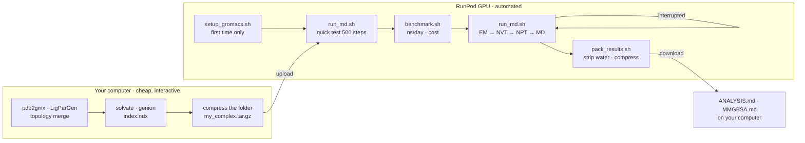

# Option: running MD on RunPod (GPUs rented by the hour)

A **500 ns** simulation on a laptop or workstation can take weeks. This guide shows how to rent a GPU on [RunPod](https://www.runpod.io/) and run **exactly the general workflow** of this repository (same `.mdp` files, same EM → NVT → NPT → MD order) with an automated pipeline that **resumes by itself after interruptions**.

> This is **optional**. The standard workflows in [`protein-protein/`](../protein-protein/README.md) and [`protein-ligand/`](../protein-ligand/holo/README.md) do not change; RunPod only changes where the time-consuming steps run.



## Scripts

| Script | What it does |
|--------|--------------|
| [`setup_gromacs.sh`](setup_gromacs.sh) | Builds GROMACS 2023.3 + CUDA **once** on the network volume (`/workspace`), detecting the GPU architecture |
| [`run_md.sh`](run_md.sh) | Non-interactive EM → NVT → NPT → MD pipeline; skips finished stages and **resumes from checkpoints** |
| [`benchmark.sh`](benchmark.sh) | Measures ns/day on the current pod and estimates hours / days / cost for 100–1000 ns |
| [`extend_md.sh`](extend_md.sh) | Extends a finished run (e.g. 100 → 500 ns) without starting over |
| [`pack_results.sh`](pack_results.sh) | Writes a **water-free** trajectory (much smaller), extracts equilibration curves, compresses everything for download |
| [`common.sh`](common.sh) | Shared helpers (real CPU count of the container, loading `gmx`, GPU detection) |

All scripts were tested end-to-end with GROMACS 2023.3 (EM → NVT → NPT → MD, interruption and resume, extension, packing).

---

## 1. Prepare the system on your computer

Follow the guide for your system **up to and including adding ions and creating the index** (these steps are interactive and fast):

| System | Follow up to | Files needed in the folder |
|--------|--------------|----------------------------|
| `pp` | [protein-protein](../protein-protein/README.md) step 5 | `*_ion.pdb` (or `solv_ions.gro`), `LM.top`, the `*.itp` files (`posre*.itp`, `*_chain_*.itp`), `index.ndx` (optional) |
| `apo` | [apo](../protein-ligand/apo/README.md) step 7 | `solv_ions.gro`, `topol.top`, the `*.itp` files, `index.ndx` |
| `holo` | [holo](../protein-ligand/holo/README.md) step 11 | `solv_ions.gro`, `topol.top`, `lig.itp`, `posre_lig.itp`, the other `*.itp` files, **`index.ndx` with the `Protein_UNL` group** |

If `topol.top` `#include`s a force-field folder inside the working directory (e.g. `./oplsaa.ff/`), copy that folder too.

Faster: [`scripts/prepare_system.sh`](../scripts/prepare_system.sh) does all of this non-interactively (including **automatic repair of missing residues / atoms** and merging the LigParGen ligand). It can also run directly on the pod after `pip install openmm pdbfixer`:

```bash
bash /workspace/gromacs-md-protocols/scripts/prepare_system.sh --system holo --pdb complex.pdb \
     --lig-gro lig.gro --lig-itp lig.itp --workdir /workspace/runs/my_complex
```

Compress the folder (in Ubuntu / WSL):

```bash
tar czf my_complex.tar.gz my_complex/
```

## 2. Create a pod on RunPod

1. Create an account and add credit at https://www.runpod.io/.
2. **Storage → Network Volume**: create a volume (about 50–100 GB for a few 500 ns runs) in a datacenter that offers the GPU you want. The volume keeps the GROMACS build and your data between pod restarts.
3. **Pods → Deploy**: choose a GPU, attach the network volume, and use the **RunPod PyTorch** template (it includes the CUDA compiler `nvcc`). The volume is usually mounted at `/workspace`.

GPU suggestions for GROMACS (one system, one GPU):

| GPU | Notes |
|-----|-------|
| RTX 4090 | usually the best performance per price for systems of tens to a few hundred thousand atoms |
| L40S / RTX 6000 Ada | similar to the 4090, more VRAM |
| A100 / H100 | more expensive; worth it only for very large systems or many replicas at once |

Prices change over time — check RunPod's pricing page, then use `benchmark.sh` to compute the real cost.

> **On-Demand vs Spot (interruptible):** Spot is cheaper but can be reclaimed at any time. This pipeline writes a checkpoint every 15 minutes and resumes when re-run, so Spot pods are fine — at most ~15 minutes of computation are lost per interruption.

## 3. Install GROMACS (once per volume)

Open the **Web Terminal** (or SSH / JupyterLab → Terminal):

```bash
cd /workspace
git clone https://github.com/129namworkkk/gromacs-md-protocols.git
bash gromacs-md-protocols/runpod/setup_gromacs.sh      # ~15–30 min
source /workspace/gromacs-2023.3-cuda/bin/GMXRC
gmx --version | grep "GPU support"                     # expect: CUDA
```

> While the repository is private, clone it with your GitHub credentials, or upload the repository folder with JupyterLab / `runpodctl`.

The default build targets architectures `80;86;89` (+ the GPU of the current pod), so later pods with an A100, A40, RTX 4090 or L40S work without rebuilding.

## 4. Upload the prepared system

For small files, the simplest way is drag-and-drop into **JupyterLab**. Or use `runpodctl` (pre-installed on every pod):

```bash
# on your computer (with runpodctl installed)
runpodctl send my_complex.tar.gz          # prints a one-time code

# on the pod
cd /workspace && mkdir -p runs && cd runs
runpodctl receive <one-time-code>
tar xzf my_complex.tar.gz
```

## 5. Quick test (strongly recommended)

Runs each stage for 500 steps in `my_complex/quicktest/` to catch topology / index / mdp errors **before** spending money:

```bash
cd /workspace
bash gromacs-md-protocols/runpod/run_md.sh --system holo --length 500 \
     --workdir /workspace/runs/my_complex --quick-test
```

## 6. Measure speed and estimate cost

```bash
R=/workspace/gromacs-md-protocols/runpod
W=/workspace/runs/my_complex

# run the real equilibration + only build md.tpr
bash $R/run_md.sh --system holo --length 500 --workdir $W --grompp-only
# measure ns/day; --price = USD per hour of the pod (see RunPod)
bash $R/benchmark.sh --workdir $W --price 0.69
```

Example output:

```text
Performance on this pod: 180.0 ns/day

  length        hours       days   cost (USD)
  100 ns         13.3       0.56         9.20
  500 ns         66.7       2.78        46.00
```

*(the numbers only illustrate how to read the output; the real speed depends on system size and GPU)*

## 7. Production run

Run inside `tmux` so the job keeps running when you close the browser:

```bash
tmux new -s md
bash /workspace/gromacs-md-protocols/runpod/run_md.sh --system holo --length 500 \
     --workdir /workspace/runs/my_complex
# detach from tmux: Ctrl+B then D      · re-attach: tmux attach -t md
```

| `--system` | `.mdp` set used | Production |
|------------|-----------------|------------|
| `pp` | `protein-protein/mdp/` | `md.mdp` (100 ns) · `md_500ns.mdp` (500 ns) |
| `apo` | `protein-ligand/apo/mdp/` | `MD.mdp` · `MD_500ns.mdp` |
| `holo` | `protein-ligand/holo/mdp/` | `MD.mdp` · `MD_500ns.mdp` |

Monitoring:

```bash
cat /workspace/runs/my_complex/STATUS                 # which stages are done
tail -f /workspace/runs/my_complex/md.log             # detailed progress
grep -E "^Performance" /workspace/runs/my_complex/*.log
```

**Interrupted (Spot reclaimed, pod restart, lost connection)?** Start the pod again and run **the same command** — the script skips the finished EM/NVT/NPT stages and continues MD from `md.cpt`.

### Extend a 100 ns run to 500 ns

```bash
bash /workspace/gromacs-md-protocols/runpod/extend_md.sh --workdir /workspace/runs/my_complex --to 500
```

The trajectory is appended to `md.xtc` (with the output frequency of the 100 ns run). Details: [docs/EXTENDED_500NS.md](../docs/EXTENDED_500NS.md).

## 8. Pack and download the results

```bash
bash /workspace/gromacs-md-protocols/runpod/pack_results.sh --workdir /workspace/runs/my_complex
runpodctl send /workspace/runs/my_complex/results_my_complex_md.tar.gz
```

The archive contains:

| File | Used for |
|------|----------|
| `md_noWater.tpr`, `md_noWater.xtc` | analysis on your computer — rename to `holo.tpr` / `holo.xtc` (or `apo.*`) and follow [ANALYSIS.md](../protein-ligand/ANALYSIS.md); the `System` group is now protein (+ ligand, ions) |
| `md_final_noWater.pdb` | quick look at the final structure in PyMOL / Chimera |
| `potential_em.xvg`, `temperature_nvt.xvg`, `pressure_npt.xvg`, `density_npt.xvg` | equilibration checks |
| `md.edr`, `*.log`, `topol.top`, `*.itp`, `index.ndx`, `mdp_used/`, `logs/` | energies, the exact parameters used, per-stage logs |

Add `--with-water` to also include the full `md.tpr` + `md.xtc` (e.g. for water-bridge analysis). The full files always stay on the volume.

## 9. Stop the pod to stop billing

- **Stop** the pod when the run is finished — GPU billing stops; the network volume is still billed for storage.
- Download all results before deleting the network volume.

---

## `run_md.sh` options

```text
--system {pp|apo|holo}   required
--length {100|500}       production length (default 100)
--workdir DIR            folder with the prepared system (default: current folder)
--start FILE             solvated + ionised structure (default: solv_ions.gro or *_ion.pdb)
--top FILE               topology (default: topol.top, or LM.top for pp)
--index FILE             index file (default: index.ndx if present; required for holo)
--stages "em nvt npt md" run only part of the workflow
--grompp-only            only build the .tpr for the last stage in --stages
--md-mdp FILE            use a custom production file (any length)
--ntomp N                OpenMP threads (default: real core count of the container)
--gpu-id ID              select the GPU
--maxwarn N              grompp -maxwarn (default: 1 for pp because of the GROMOS warning,
                         1 for apo/holo NPT because of the Berendsen barostat; 0 otherwise)
--quick-test             500 steps per stage in WORKDIR/quicktest
```

Each stage logs to `WORKDIR/logs/<stage>.grompp.log` and `<stage>.mdrun.log`. If `grompp` fails, the script prints the last 40 lines of its log and stops.

## Running replicas

Many journals expect 3 independent replicas. Copy the prepared folder to `rep1/ rep2/ rep3/` and run each one (one replica per GPU, or one after another). `gen_seed = -1` in `NVT.mdp` / `nvt.mdp` gives every replica different initial velocities.

```bash
for r in rep1 rep2 rep3; do
  bash /workspace/gromacs-md-protocols/runpod/run_md.sh --system holo --length 500 \
       --workdir /workspace/runs/$r
done
```
