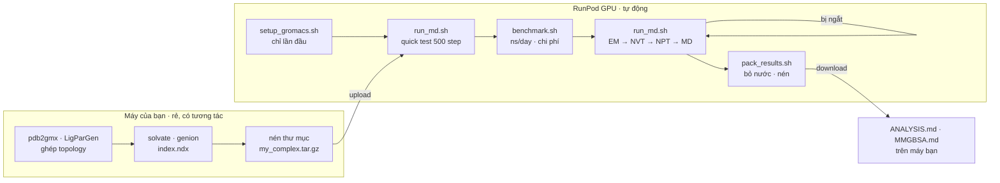

# Tuỳ chọn: chạy MD trên RunPod (GPU thuê theo giờ)

Mô phỏng **500 ns** trên laptop/PC có thể mất nhiều tuần. Phần này hướng dẫn thuê GPU trên [RunPod](https://www.runpod.io/) và chạy **đúng quy trình chung** của repo (cùng file `.mdp`, cùng thứ tự EM → NVT → NPT → MD) bằng một pipeline tự động, **tự chạy tiếp khi bị ngắt**.

> Đây là **tuỳ chọn**. Quy trình chuẩn trong [`protein-protein/`](../protein-protein/README.md) và [`protein-ligand/`](../protein-ligand/holo/README.md) không thay đổi; RunPod chỉ thay chỗ chạy các bước tốn thời gian.



## Các script

| Script | Việc làm |
|--------|----------|
| [`setup_gromacs.sh`](setup_gromacs.sh) | Build GROMACS 2023.3 + CUDA **một lần** vào network volume (`/workspace`), tự nhận kiến trúc GPU |
| [`run_md.sh`](run_md.sh) | Pipeline EM → NVT → NPT → MD không cần tương tác; bỏ qua bước đã xong, **tự resume từ checkpoint** |
| [`benchmark.sh`](benchmark.sh) | Đo ns/day trên pod hiện tại và ước tính giờ / ngày / tiền cho 100–1000 ns |
| [`extend_md.sh`](extend_md.sh) | Kéo dài một run đã xong (ví dụ 100 → 500 ns) mà không chạy lại từ đầu |
| [`pack_results.sh`](pack_results.sh) | Tạo trajectory **không có nước** (nhỏ hơn nhiều), xuất đường cân bằng, nén để tải về |
| [`common.sh`](common.sh) | Hàm dùng chung (số CPU thật của container, nạp `gmx`, phát hiện GPU) |

Tất cả script đã được chạy thử end-to-end với GROMACS 2023.3 (EM → NVT → NPT → MD, ngắt giữa chừng rồi resume, extend, pack).

---

## 1. Chuẩn bị trên máy của bạn

Làm theo guide của hệ bạn **đến hết bước thêm ion và tạo index** (các bước này có tương tác và rất nhanh):

| Hệ | Làm đến bước | File cần có trong thư mục |
|----|--------------|---------------------------|
| `pp` | [protein-protein](../protein-protein/README.md) bước 5 | `*_ion.pdb` (hoặc `solv_ions.gro`), `LM.top`, các `*.itp` (`posre*.itp`, `*_chain_*.itp`), `index.ndx` (tuỳ chọn) |
| `apo` | [apo](../protein-ligand/apo/README.md) bước 7 | `solv_ions.gro`, `topol.top`, các `*.itp`, `index.ndx` |
| `holo` | [holo](../protein-ligand/holo/README.md) bước 11 | `solv_ions.gro`, `topol.top`, `lig.itp`, `posre_lig.itp`, các `*.itp` khác, **`index.ndx` có nhóm `Protein_UNL`** |

Nếu `topol.top` `#include` một thư mục force field nằm trong thư mục làm việc (ví dụ `./oplsaa.ff/`), copy cả thư mục đó.

Nén lại (trong Ubuntu/WSL):

```bash
tar czf my_complex.tar.gz my_complex/
```

## 2. Tạo pod trên RunPod

1. Tạo tài khoản và nạp credit tại https://www.runpod.io/.
2. **Storage → Network Volume**: tạo volume (khoảng 50–100 GB cho vài run 500 ns) ở datacenter có GPU bạn muốn. Volume giữ lại GROMACS đã build và dữ liệu giữa các lần bật/tắt pod.
3. **Pods → Deploy**: chọn GPU, gắn network volume vừa tạo, template **RunPod PyTorch** (có sẵn CUDA compiler `nvcc`). Volume thường được mount ở `/workspace`.

Gợi ý chọn GPU cho GROMACS (một hệ, một GPU):

| GPU | Ghi chú |
|-----|---------|
| RTX 4090 | thường có tỉ lệ hiệu năng/giá tốt nhất cho hệ vài chục – vài trăm nghìn atom |
| L40S / RTX 6000 Ada | tương đương 4090, nhiều VRAM hơn |
| A100 / H100 | đắt hơn; chỉ đáng khi hệ rất lớn hoặc chạy nhiều replica cùng lúc |

Giá thay đổi theo thời gian — xem trang pricing của RunPod rồi dùng `benchmark.sh` để tính chi phí thật.

> **On-Demand vs Spot (interruptible):** Spot rẻ hơn nhưng có thể bị thu hồi bất kỳ lúc nào. Pipeline này lưu checkpoint mỗi 15 phút và resume khi chạy lại, nên dùng Spot được — chỉ mất tối đa ~15 phút tính toán mỗi lần bị ngắt.

## 3. Cài GROMACS (chỉ lần đầu cho mỗi volume)

Mở **Web Terminal** (hoặc SSH / JupyterLab → Terminal):

```bash
cd /workspace
git clone https://github.com/129namworkkk/gromacs-md-protocols.git
bash gromacs-md-protocols/runpod/setup_gromacs.sh      # ~15–30 phút
source /workspace/gromacs-2023.3-cuda/bin/GMXRC
gmx --version | grep "GPU support"                     # cần thấy: CUDA
```

> Repo đang để private: dùng `git clone` với tài khoản GitHub của bạn, hoặc upload thư mục repo bằng JupyterLab / `runpodctl`.

Build mặc định cho kiến trúc `80;86;89` (+ GPU của pod hiện tại), nên lần sau dùng pod A100, A40, RTX 4090 hay L40S vẫn chạy được mà không cần build lại.

## 4. Upload hệ đã chuẩn bị

Cách đơn giản nhất cho file nhỏ là kéo thả vào **JupyterLab**. Hoặc dùng `runpodctl` (có sẵn trên mọi pod):

```bash
# trên máy của bạn (đã cài runpodctl)
runpodctl send my_complex.tar.gz          # in ra một mã dùng một lần

# trên pod
cd /workspace && mkdir -p runs && cd runs
runpodctl receive <mã-vừa-in>
tar xzf my_complex.tar.gz
```

## 5. Chạy thử nhanh (bắt buộc nên làm)

Chạy mỗi bước 500 step trong `my_complex/quicktest/` để bắt lỗi topology / index / mdp **trước khi** tốn tiền:

```bash
cd /workspace
bash gromacs-md-protocols/runpod/run_md.sh --system holo --length 500 \
     --workdir /workspace/runs/my_complex --quick-test
```

## 6. Đo tốc độ và ước tính chi phí

```bash
R=/workspace/gromacs-md-protocols/runpod
W=/workspace/runs/my_complex

# chạy cân bằng thật + chỉ tạo md.tpr
bash $R/run_md.sh --system holo --length 500 --workdir $W --grompp-only
# đo ns/day; --price = USD/giờ của pod (xem trên RunPod)
bash $R/benchmark.sh --workdir $W --price 0.69
```

Ví dụ output:

```text
Performance on this pod: 180.0 ns/day

  length        hours       days   cost (USD)
  100 ns         13.3       0.56         9.20
  500 ns         66.7       2.78        46.00
```

*(số trên chỉ minh hoạ cách đọc; tốc độ thật phụ thuộc kích thước hệ và GPU)*

## 7. Chạy production

Chạy trong `tmux` để đóng trình duyệt vẫn tiếp tục:

```bash
tmux new -s md
bash /workspace/gromacs-md-protocols/runpod/run_md.sh --system holo --length 500 \
     --workdir /workspace/runs/my_complex
# tách khỏi tmux: Ctrl+B rồi D      · quay lại: tmux attach -t md
```

| `--system` | Bộ `.mdp` dùng | Production |
|------------|----------------|------------|
| `pp` | `protein-protein/mdp/` | `md.mdp` (100 ns) · `md_500ns.mdp` (500 ns) |
| `apo` | `protein-ligand/apo/mdp/` | `MD.mdp` · `MD_500ns.mdp` |
| `holo` | `protein-ligand/holo/mdp/` | `MD.mdp` · `MD_500ns.mdp` |

Theo dõi:

```bash
cat /workspace/runs/my_complex/STATUS                 # bước nào đã xong
tail -f /workspace/runs/my_complex/md.log             # tiến độ chi tiết
grep -E "^Performance" /workspace/runs/my_complex/*.log
```

**Bị ngắt (Spot bị thu hồi, pod restart, mất kết nối)?** Bật lại pod và chạy **đúng lệnh cũ** — script bỏ qua EM/NVT/NPT đã xong và chạy tiếp MD từ `md.cpt`.

### Kéo dài run 100 ns thành 500 ns

```bash
bash /workspace/gromacs-md-protocols/runpod/extend_md.sh --workdir /workspace/runs/my_complex --to 500
```

Trajectory được nối tiếp vào `md.xtc` (giữ tần suất lưu của run 100 ns). Chi tiết: [docs/EXTENDED_500NS.md](../docs/EXTENDED_500NS.md).

## 8. Đóng gói và tải kết quả

```bash
bash /workspace/gromacs-md-protocols/runpod/pack_results.sh --workdir /workspace/runs/my_complex
runpodctl send /workspace/runs/my_complex/results_my_complex_md.tar.gz
```

Archive chứa:

| File | Dùng cho |
|------|----------|
| `md_noWater.tpr`, `md_noWater.xtc` | phân tích trên máy bạn — đổi tên thành `holo.tpr` / `holo.xtc` (hoặc `apo.*`) rồi làm theo [ANALYSIS.md](../protein-ligand/ANALYSIS.md); nhóm `System` lúc này là protein (+ ligand, ion) |
| `md_final_noWater.pdb` | xem nhanh cấu trúc cuối trong PyMOL / Chimera |
| `potential_em.xvg`, `temperature_nvt.xvg`, `pressure_npt.xvg`, `density_npt.xvg` | kiểm tra cân bằng |
| `md.edr`, `*.log`, `topol.top`, `*.itp`, `index.ndx`, `mdp_used/`, `logs/` | năng lượng, tham số thật đã dùng, nhật ký từng bước |

Thêm `--with-water` nếu cần cả `md.tpr` + `md.xtc` đầy đủ (ví dụ phân tích water bridge). File đầy đủ luôn được giữ trên volume.

## 9. Tắt pod để dừng tính tiền

- **Stop** pod khi chạy xong — GPU ngừng tính tiền; network volume vẫn tính phí lưu trữ.
- Tải hết kết quả về rồi mới xoá network volume.

---

## Tuỳ chọn của `run_md.sh`

```text
--system {pp|apo|holo}   bắt buộc
--length {100|500}       độ dài production (mặc định 100)
--workdir DIR            thư mục hệ đã chuẩn bị (mặc định: thư mục hiện tại)
--start FILE             cấu trúc đã solvate + ion (mặc định: solv_ions.gro hoặc *_ion.pdb)
--top FILE               topology (mặc định: topol.top, hoặc LM.top cho pp)
--index FILE             index (mặc định: index.ndx nếu có; bắt buộc với holo)
--stages "em nvt npt md" chạy một phần quy trình
--grompp-only            chỉ tạo .tpr cho bước cuối trong --stages
--md-mdp FILE            dùng file production riêng (độ dài tuỳ ý)
--ntomp N                số OpenMP thread (mặc định: số core thật của container)
--gpu-id ID              chọn GPU
--maxwarn N              -maxwarn cho grompp (mặc định: 1 cho pp vì cảnh báo GROMOS,
                         1 cho NPT của apo/holo vì barostat Berendsen; còn lại 0)
--quick-test             500 step mỗi bước trong WORKDIR/quicktest
```

Mỗi bước ghi log vào `WORKDIR/logs/<bước>.grompp.log` và `<bước>.mdrun.log`. Nếu `grompp` báo lỗi, script in 40 dòng cuối của log và dừng.

## Chạy nhiều replica

Nhiều tạp chí yêu cầu 3 replica độc lập. Copy thư mục đã chuẩn bị thành `rep1/ rep2/ rep3/` và chạy từng cái (mỗi GPU một replica, hoặc lần lượt). `gen_seed = -1` trong `NVT.mdp` / `nvt.mdp` đảm bảo mỗi replica có vận tốc ban đầu khác nhau.

```bash
for r in rep1 rep2 rep3; do
  bash /workspace/gromacs-md-protocols/runpod/run_md.sh --system holo --length 500 \
       --workdir /workspace/runs/$r
done
```
